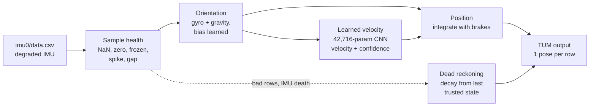

# Path Finder

**Trajectory from a degraded IMU alone, in 2.5 MB and 1.8 ms per second of data.**

Samsung PRISM XR Hackathon 2026 · Track 3: *Path Finder, Trajectory Estimation Under Sensor Degradation*
Team **California Burrito** · SRM Institute of Science and Technology, Kattankulathur

[](https://github.com/rehaanajani/pathfinder-xr/actions/workflows/track3.yml)

| Submission | |
|---|---|
| Video (2.5 min, narrated) | **[Watch on Google Drive](https://drive.google.com/file/d/1fMtWITCb1RfrTKooN9tEU_daj5p_4nbL/view?usp=sharing)** · in the repo: [`docs/media/PathFinder_Track3.mp4`](docs/media/PathFinder_Track3.mp4) |
| Presentation | **[Open in Google Slides](https://docs.google.com/presentation/d/1UhfNcmeuGhQjBOyQcsvGrlvwcIb-xog0/edit?usp=sharing)** · in the repo: [`deck/SRMIST_CaliforniaBurrito.pptx`](deck/SRMIST_CaliforniaBurrito.pptx) (Samsung's template) |
| Source code (the scored entry) | [`src/`](src/README.md): `main.cpp` (C++17), `main.py` (readable reference, same output) |
| Benchmark reports | [`docs/reports/`](docs/reports/README.md): Windows laptop, MacBook, Galaxy phone |
| AI disclosure | [`AI_DISCLOSURE.md`](AI_DISCLOSURE.md) |

---

## The problem

Every XR headset and phone tracks motion with an IMU. Track 3 jams that IMU: noise and bias drift rise over time,
readings spike, freeze, duplicate and drop out, and finally the sensor dies. The entry must still output a 6-DoF
pose for every input row, including 5 s after the IMU dies, using **only** that IMU stream, in **8 MB** of memory
and **20 ms per second of data**, on one CPU thread.

Integrating the damaged signal as it is fails completely: on EuRoC MH_05 damaged by the organisers' own script, plain
integration is **72 km** off after 113 s.

## Results

All numbers below are measured, with the raw files linked. Accuracy is on the **organisers' own degradation script**
(`degrade_imu.py`, their seed 42, their documented accel-first columns), SE(3)-aligned like evo.

**All 17 public recordings (11 EuRoC + 6 TUM-VI), metres, lower is better:**

| | ATE | Checkpoints | Blind 5 s | Dropouts | Drift over 1 s |
|---|---:|---:|---:|---:|---:|
| Standing still | 2.62 | 2.45 | 2.28 | 2.42 | 0.77 |
| **Path Finder** | **2.32** | **2.13** | **2.24** | **2.13** | **0.57** |
| Improvement | **−12 %** | **−13 %** | **−2 %** | **−12 %** | **−26 %** |

- **Better on every one of the 17 recordings** for ATE, checkpoints, dropouts and drift
  ([`results/track3/coupling_sweep.md`](results/track3/coupling_sweep.md)).
- **Never trained on** (MH_05, V2_03, room6): ATE **3.10 m vs 3.31 m**, checkpoints 2.90 vs 3.03, dropouts 2.93 vs
  3.14, drift 0.70 vs 0.79.
- **XR headsets** (8 Monado recordings, IMU mounted unlike any training data): **0.57 m vs 0.84 m**, 32 % lower,
  thanks to the mount guard.

<sub>Per recording: better on 17 / 17 for ATE, checkpoints, dropouts and drift; the blind 5 s is better on average
and on 12 / 17.</sub>

**Resources (C++ entry, worst of 5 recordings):**

| Machine | Peak memory | CPU per second of IMU | Report |
|---|---:|---:|---|
| MacBook Air, Apple M5 | **2.5 MB** | **1.8 ms** | [02](docs/reports/02_macbook.md) |
| Samsung Galaxy M36 phone CPU (Exynos 1380) | 4.0 MB | 5.0 ms | [03](docs/reports/03_phone.md) |
| Windows laptop, i7-11800H under WSL | 5.1 MB | 14.0 ms | [01](docs/reports/01_windows_laptop.md) |
| *Budget* | *8 MB* | *20 ms* | |

Every machine produces the same trajectory: the phone's output matched the Mac's byte for byte, and the C++ entry
matches the Python reference to 1 µm. Memory and CPU sit at **31 % and 9 % of the budget** on the Mac.

## Quick start

```bash
make -C src                                            # C++17 compiler + zlib
src/pathfinder path/to/imu0_folder -o estimated_trajectory.txt
```

or with Docker:

```bash
docker build -t pathfinder src/
docker run --rm -v "$PWD/data:/data" pathfinder /data -o /data/estimated_trajectory.txt
```

**Input:** a folder with `imu0/data.csv` (or `mav0/imu0/data.csv`), a `.zip` of it, or the CSV itself. Both column
orders are detected (EuRoC `timestamp, gyro, accel` and the organisers' `timestamp, accel, gyro`), as are timestamps
in s/ms/µs/ns and acceleration in m/s² or g; it prints what it found. **Output:** TUM format,
`timestamp tx ty tz qx qy qz qw`, one pose per input row. Full options: [`src/README.md`](src/README.md).

## How it works



1. **Check every sample.** NaN/inf, all-zero, frozen (bit-identical repeats), physically impossible values and time
   gaps are caught row by row. Duplicated and out-of-order rows are handled.
2. **Start blind.** Gravity direction and gyro bias come from the data (the first still stretch); no ground truth,
   no calibration.
3. **Physics with brakes.** Strapdown integration with gravity correction, zero-velocity updates when still, a soft
   speed limit and a gentle pull back to the start point so drift cannot run away.
4. **Learned velocity.** A small 1-D CNN reads 1 s of body-frame IMU (AirIO style) and predicts velocity and its own
   uncertainty; the filter weights it by that uncertainty. It runs inside the C++ entry with no ML runtime
   (171 KB of weights). If the IMU is mounted unlike the training data, a mount guard switches to a
   gravity-aligned network ([`docs/MOUNT_GUARD.md`](docs/MOUNT_GUARD.md)).
5. **Coast when blind.** Through dropouts and the 5 s after the IMU dies, turn rate and speed decay from the last
   trusted state.

Design notes: [`docs/AIRIO.md`](docs/AIRIO.md) (network), [`docs/LEARNED_VELOCITY.md`](docs/LEARNED_VELOCITY.md),
[`docs/TRACK3_BRIEF.md`](docs/TRACK3_BRIEF.md) (the brief), [`docs/TRACK3_STATUS.md`](docs/TRACK3_STATUS.md).

## Proof

| Claim | Evidence |
|---|---|
| Accuracy on the organisers' script | [`results/track3/`](results/track3/README.md), [`coupling_sweep.md`](results/track3/coupling_sweep.md); reproduce with `tools/eval_organiser.py --script <degrade_imu.py> --data euroc:MH_05_difficult ...` |
| Memory and CPU budgets | [`results/track3/budget.json`](results/track3/budget.json), [`docs/reports/`](docs/reports/README.md); `tools/measure_budget.py`, `tools/benchmark_report.sh` |
| Runs on a phone's CPU | [`results/reports/phone_SM-M366B.json`](results/reports/phone_SM-M366B.json); `tools/android/bench_on_phone.sh` |
| One pose per row through every fault | CI on every push (badge above): build, stress tests, Docker image run |
| Rotated IMU handled | [`results/track3/mount_guard_check.json`](results/track3/mount_guard_check.json); CI flips the IMU inside Docker |
| Every alternative was measured, not guessed | [`results/track3/retrain_organiser.md`](results/track3/retrain_organiser.md) (retraining on the organisers' damage, a 4× larger network, a 2 s window), [`coupling_sweep.md`](results/track3/coupling_sweep.md) (9 settings × 25 recordings), [`docs/RESEARCH_REVIEW.md`](docs/RESEARCH_REVIEW.md) |

## Tests

```bash
make -C src
PF_ENTRY=cpp python -m pytest -q tests/stress     # C++ entry: 58 tests
python -m pytest -q tests/stress                  # Python reference
```

| Suite | What it checks |
|---|---|
| `test_main_contract.py` | one pose per row; header variants, trailing lines, NaN/inf, zero, frozen, missing, duplicate and out-of-order rows; truncated and tiny files; rotated gravity; the 5 s blind extension; 8 MB and 20 ms/s budgets |
| `test_layout.py` | both column orders, timestamps in s/ms/µs/ns (including jittered 1 kHz ns), acceleration in g |
| `test_review_fixes.py` | regressions from independent reviews: zero acceleration at start, start-up boundary, a 100,000-file zip, a 3 s gap |
| `test_mount_guard.py` | switching networks for an IMU mounted another way |

## Safeguards

- **Never crashes on bad input**: every row gets a finite pose and a unit quaternion, whatever it contains.
- **Streams the input** row by row: memory does not grow with the length of the recording.
- **Says what it assumed**: column order, units and network choice are printed on stderr; flags override them.
- **No fast-math**, one thread, fixed arithmetic: the same output on every machine we tried.
- **Settings chosen to generalise**: the default beats standing still on all 17 recordings; settings that scored
  higher on some recordings but not on all of them were rejected, so the result holds on data we have not seen.

## Design choices

- **Bounded drift by design.** An IMU alone cannot observe absolute heading or position, so Path Finder pulls its
  estimate gently back toward the start and weights the network by its own confidence. That is what keeps it ahead
  of standing still on every recording, from small rooms to 20 m drone flights.
- **Room to grow.** With a perfect velocity network the same filter reaches 1.95 m on our validation set
  ([`retrain_organiser.md`](results/track3/retrain_organiser.md)); more training data is the next lever, and the
  pipeline to retrain and re-score in minutes is already in `tools/`.
- **Clean evaluation.** 11 of the 17 recordings trained the network; the 3 it never saw are reported separately above.

## Beyond the scored task

The same ideas on real hardware, with cameras and several IMUs:

- **Live Galaxy phone demo**: the phone streams its IMU and camera tracking to a laptop dashboard; with the camera
  covered, Path Finder keeps tracking and reports its own uncertainty ([`docs/reports/03_phone.md`](docs/reports/03_phone.md)).
- **The scored entry on a phone's CPU**: 4.0 MB and 5.0 ms per second of data on a Galaxy M36.
- **Real VR headsets**: IMU clipping on Samsung Odyssey+ and Valve Index recordings, spotted from the data itself.
- **Several IMUs**: sensors on one rigid frame must agree; a biased, stuck or spiking one is voted out.

These live in [`demo_line/`](demo_line/README.md) and [`docs/WIDER_SYSTEM.md`](docs/WIDER_SYSTEM.md).

## Repository map

| Path | What |
|---|---|
| `src/` | **the scored entry**: `main.cpp`, `main.py`, network weights, Makefile, Dockerfile |
| `tests/stress/` | entry tests (run in CI) |
| `tools/` | evaluation (`eval_organiser.py`, `score_track3.py`), budgets, training (`train_airio.py`), phone benchmark (`android/`), video (`video/`) |
| `results/` | raw results behind every number |
| `docs/` | brief, design notes, benchmark reports, the wider camera system |
| `deck/` | the presentation and the script that builds it from measured numbers |
| `demo_line/` | live phone demo and multi-sensor work, beyond the scored task |

## Team

Rehaan Ajani (lead) · Nikhil Solanki · Debadrita Haldar · Mayank Yadav

AI tools were used as coding and review assistants; see [`AI_DISCLOSURE.md`](AI_DISCLOSURE.md).
