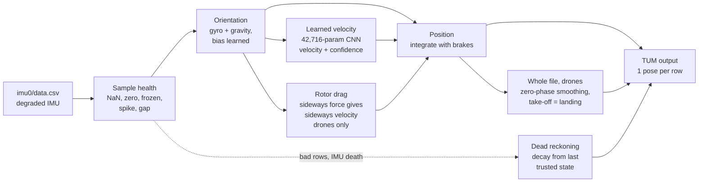

# 길잡이 · Giljabi

<sub>길잡이 (gil-ja-bi): Korean for "the one who finds the way", a guide. Our entry for the Path Finder track.</sub>

**6-DoF trajectory from a degraded IMU alone: about 45 % less error than standing still, in 3.5 MiB of memory and 6 ms per second of data.**

Samsung PRISM XR Hackathon 2026 · Track 3: *Path Finder, Trajectory Estimation Under Sensor Degradation*
Team **California Burrito** · SRM Institute of Science and Technology, Kattankulathur
Rehaan Ajani (lead) · Nikhil Solanki · Mayank Yadav · Debadrita Haldar

[](https://github.com/rehaanajani/pathfinder-xr/actions/workflows/track3.yml)

## Submission

| Item | Where |
|---|---|
| **Source code** | [`src/main.py`](src/main.py): Python, network weights embedded; needs only Python 3 and numpy |
| **Presentation** | **[Google Slides](https://docs.google.com/presentation/d/1m3OZiMzlMfgZEZ3Lyf8iNLHis_BDRbju/edit?usp=sharing)** · [`deck/SRMIST_CaliforniaBurrito.pptx`](deck/SRMIST_CaliforniaBurrito.pptx) (Samsung's template) |
| **Video** (under 3 min, narrated) | **[Google Drive](https://drive.google.com/file/d/1nX8n_IJVjvUbYx03Qe8aF-BZF9VN2FaQ/view?usp=sharing)** · [`docs/media/Giljabi_Track3.mp4`](docs/media/Giljabi_Track3.mp4) |
| **AI disclosure** | [`AI_DISCLOSURE.md`](AI_DISCLOSURE.md) |
| **README** | this page |
| Output | `estimated_trajectory.txt`, TUM format, exactly one pose per input IMU row |
| Benchmark reports | [`docs/reports/`](docs/reports/README.md): Windows laptop, MacBook, Galaxy phone |

## Install and run

```bash
git clone https://github.com/rehaanajani/pathfinder-xr.git
cd pathfinder-xr
pip install numpy
python3 src/main.py path/to/imu0_folder -o estimated_trajectory.txt
```

Needs only Python 3 and numpy; `src/main.py` is self-contained and can be copied anywhere on its own. **Input:** a folder with `imu0/data.csv` (or
`mav0/imu0/data.csv`, or the `imu0` folder itself), a `.zip` of it, or the CSV itself; with no argument it looks in the
current folder, and the output can also be given as a second argument. Both column orders are detected (EuRoC
`timestamp, gyro, accel` and the organisers' `timestamp, accel, gyro`), as are timestamps in s/ms/µs/ns and
acceleration in m/s² or g; it prints what it found. **Output:** `timestamp tx ty tz qx qy qz qw`, one pose per input
row, including the rows after the IMU dies. Options: `python3 src/main.py --help` and [`src/README.md`](src/README.md).

With Docker (the image contains only `main.py`):

```bash
docker build -t pathfinder src/
docker run --rm -v "$PWD/data:/data" pathfinder /data -o /data/estimated_trajectory.txt
```

## The problem

Every XR headset and phone tracks motion with an IMU. Track 3 jams that IMU: noise and bias drift rise over time,
readings spike, freeze, duplicate and drop out, and finally the sensor dies. The entry must still output a 6-DoF
pose for every input row, including 5 s after the IMU dies, using **only** that IMU stream, in **8 MB** and
**20 ms per second of data**, on one CPU thread.

Integrating the damaged signal as it is fails completely: on EuRoC MH_05 damaged by the organisers' own script, plain
integration is **72 km** off after 113 s.

### Official rules and how we meet them

From the organisers' Track 3 slides and their official FAQ (`Track3_FAQ_Responses.txt`, sent with `degrade_imu.py` on
16 Nov 2026).

| Rule | Our entry |
|---|---|
| Standalone Python script, `main.py` | [`src/main.py`](src/main.py), one file, needs only Python 3 and numpy |
| ≤ 8 MB peak memory, measured at the algorithm / heap level | 3.5 MiB algorithm heap ([`python_budget.json`](results/track3/python_budget.json)) |
| ≤ 20 ms compute per 1 s of IMU, one CPU thread, offline | 5.8 ms per second, one thread |
| Exactly one pose per IMU row, nothing appended | One output row per input row by design, checked in [`tests/stress`](tests/stress) |
| Dropouts are missing rows; blind 5 s rows carry invalid values | Gaps bridged from timestamps; dead-sensor rows detected and dead-reckoned |
| Only the degraded IMU file as input; waypoints hidden | No other input is read |
| Offline, non-causal processing allowed | Used on drones: whole-flight zero-phase smoothing and a take-off / landing loop closure |
| Scored with evo ATE and RPE after SE(3) (Umeyama) alignment | Our own scoring uses the same alignment ([`tools/score_track3.py`](tools/score_track3.py)) |
| Scoring: memory 20 · runtime 20 · checkpoints 30 · blind 5 s 20 · dropouts 10 | Results below, per window |
| Demo video 2-3 min, at most 3 | under 3 min |

## Results

All numbers are measured, with the raw files linked. Accuracy uses the **organisers' own degradation script**
(`degrade_imu.py`, their seed, their documented accel-first columns), SE(3)-aligned like evo; what each metric
measures is in [`results/track3/README.md`](results/track3/README.md#current-results-organisers-degradation-script).

**All 17 public recordings (11 EuRoC + 6 TUM-VI), metres, lower is better:**

| | ATE | Checkpoints | Blind 5 s | Dropouts | Drift over 1 s |
|---|---:|---:|---:|---:|---:|
| Standing still | 2.62 | 2.45 | 2.28 | 2.42 | 0.77 |
| **Giljabi** | **1.47** | **1.35** | **1.37** | **1.36** | **0.42** |
| Improvement | **~44 %** | **~45 %** | **~40 %** | **~44 %** | **~46 %** |

- **Per recording** ([`per_recording.md`](results/track3/per_recording.md), raw:
  [`organiser_per_recording.json`](results/track3/organiser_per_recording.json)): better than standing still on
  17 / 17 for drift, 16 / 17 for checkpoints and dropouts, 15 / 17 for ATE.
- **Never trained on** (MH_05, V2_03, room6): ATE **1.99 m vs 3.31 m**, checkpoints 1.77 vs 3.03, blind 1.54 vs 2.41,
  dropouts 1.88 vs 3.14, drift 0.60 vs 0.79.
- **Fresh corruption seeds** (the organisers' script with its seed changed to 1, 7 and 2026): ATE 1.45-1.54 m vs
  2.62 m standing still, checkpoints 1.31-1.42 vs 2.45, blind 1.36-1.61 vs 2.28
  ([`loop_closure.md`](results/track3/loop_closure.md)).
- **XR headsets** (8 Monado recordings, IMU mounted unlike any training data): **0.59 m vs 0.83 m**, better on 8 / 8,
  thanks to the mount guard.

<sub>The blind 5 s is better on average and on 12 / 17 recordings.</sub>

**Resources** (worst of 6 recordings with the organisers' damage, MacBook Air M5,
Python 3.11; [`python_budget.json`](results/track3/python_budget.json), `tools/measure_python_budget.py`):

| | Measured | Budget |
|---|---:|---:|
| Peak heap of the algorithm (tracemalloc: data structures, buffers, estimation; the interpreter and numpy excluded) | **3.5 MiB** | 8 MB |
| Everything after numpy, including compiling `main.py` with its embedded network | **6.6 MiB** | 8 MB |
| CPU per second of IMU, one thread | **5.8 ms** | 20 ms |

**Same algorithm in C++** (`src/main.cpp`, output within 3 µm of `main.py`) for on-device use (measured on an earlier
build):

| Machine | Peak memory (process) | CPU per second of IMU | Report |
|---|---:|---:|---|
| MacBook Air, Apple M5 | 2.5 MB | 1.8 ms | [02](docs/reports/02_macbook.md) |
| Samsung Galaxy M36 phone CPU (Exynos 1380) | 4.0 MB | 5.0 ms | [03](docs/reports/03_phone.md) |
| Windows laptop, i7-11800H under WSL | 5.1 MB | 14.0 ms | [01](docs/reports/01_windows_laptop.md) |

## How it works



1. **Check every sample.** NaN/inf, all-zero, frozen (bit-identical repeats), physically impossible values and time
   gaps are caught row by row. Duplicated and out-of-order rows are handled; short stuck runs (a reading copied onto
   the next rows) are replaced by readings interpolated between the real rows on each side, and short dropouts are
   bridged the same way.
2. **Start blind.** Gravity direction and gyro bias come from the data (the first still stretch, then a silent first
   pass over the first 10 s); no ground truth, no calibration.
3. **Physics with brakes.** Strapdown integration with gravity correction, zero-velocity updates when still, a soft
   speed limit and a gentle pull back to the start point so drift cannot run away.
4. **Learned velocity.** A small 1-D CNN reads 1 s of body-frame IMU (AirIO style) and predicts velocity and its own
   uncertainty; the filter weights it by that uncertainty. Its weights are embedded in `main.py`. If the IMU is
   mounted unlike the training data, a mount guard switches to a gravity-aligned network
   ([`docs/MOUNT_GUARD.md`](docs/MOUNT_GUARD.md)).
5. **Rotor drag (drones).** A multirotor's sideways acceleration is proportional to its sideways speed, so the
   accelerometer measures the drone's velocity in its own frame, with no heading needed. It switches on only when
   start-up gravity matches the drone's thrust axis, and then the pull to the start can be gentler (12 s instead of
   3 s). Handheld and headset recordings are unaffected ([`rotor_drag.md`](results/track3/rotor_drag.md)).
6. **Use the whole file (drones).** The FAQ allows offline processing. Up to the moment the IMU dies, the pull to the
   start is replaced by a zero-phase (forward-backward) one whose time constant shortens as the damage grows; its
   input uses rotor-drag readings with their measured offset removed. A drone lands back on its pad, so the gap between
   the position at take-off (found from the IMU: the drone resting before it lifts off) and at the failure is drift,
   removed over the flight ([`zero_phase_drone.md`](results/track3/zero_phase_drone.md),
   [`loop_closure.md`](results/track3/loop_closure.md)).
7. **Coast when blind.** Through dropouts and the 5 s after the IMU dies, turn rate and speed decay from the last
   trusted state.

Design notes: [`docs/AIRIO.md`](docs/AIRIO.md) (network), [`docs/LEARNED_VELOCITY.md`](docs/LEARNED_VELOCITY.md),
[`docs/TRACK3_BRIEF.md`](docs/TRACK3_BRIEF.md) (the brief), [`docs/TRACK3_STATUS.md`](docs/TRACK3_STATUS.md).

## Proof

| Claim | Evidence |
|---|---|
| Accuracy on the organisers' script | [`per_recording.md`](results/track3/per_recording.md), [`organiser_per_recording.json`](results/track3/organiser_per_recording.json) (`main.py`), the same scores from the C++ port in [`organiser_per_recording_cpp.json`](results/track3/organiser_per_recording_cpp.json); reproduce with `tools/eval_organiser.py --script <degrade_imu.py> --data euroc:MH_05_difficult ...` |
| Memory and CPU of `main.py` | [`python_budget.json`](results/track3/python_budget.json); `tools/measure_python_budget.py` |
| `main.py` runs on its own | `tests/stress/test_standalone.py`: copied alone into an empty folder, identical output; embedded weights byte-identical to `src/velnet_weights*.bin` |
| One pose per row through every fault | CI on every push (badge above): stress tests, Docker image run |
| Rotated IMU handled | [`mount_guard_check.json`](results/track3/mount_guard_check.json); CI flips the IMU inside Docker |
| Rotor drag and the drone pull | [`rotor_drag.md`](results/track3/rotor_drag.md): fit against motion capture, about 20 settings × 25 recordings |
| Each later step, checked on 17 recordings × 4 corruption seeds | [`gap_bridge_rotor.md`](results/track3/gap_bridge_rotor.md) (dropout bridging), [`zero_phase_drone.md`](results/track3/zero_phase_drone.md) (drone smoothing), [`two_pass_on_smoothing.md`](results/track3/two_pass_on_smoothing.md) (two-pass start), [`stuck_runs.md`](results/track3/stuck_runs.md) (stuck runs), [`drag_offset_smoothing.md`](results/track3/drag_offset_smoothing.md) (drag offset), [`loop_closure.md`](results/track3/loop_closure.md) (take-off / landing) |
| Ideas tried and not kept | [`blind_and_handheld.md`](results/track3/blind_and_handheld.md), and one page per idea in the pull requests that record them |
| Every alternative was measured | [`retrain_organiser.md`](results/track3/retrain_organiser.md) (retraining on the organisers' damage, a 4× larger network, a 2 s window), [`coupling_sweep.md`](results/track3/coupling_sweep.md) (9 settings × 25 recordings), [`docs/RESEARCH_REVIEW.md`](docs/RESEARCH_REVIEW.md) |
| C++ port on three machines | [`docs/reports/`](docs/reports/README.md), [`phone_SM-M366B.json`](results/reports/phone_SM-M366B.json) |

## Tests

```bash
python -m pytest -q tests/stress                  # main.py
make -C src && PF_ENTRY=cpp python -m pytest -q tests/stress     # the C++ port
```

| Suite | What it checks |
|---|---|
| `test_main_contract.py` | one pose per row; header variants, trailing lines, NaN/inf, zero, frozen, missing, duplicate and out-of-order rows; truncated and tiny files; rotated gravity; budgets |
| `test_layout.py` | both column orders, timestamps in s/ms/µs/ns (including jittered 1 kHz ns), acceleration in g |
| `test_review_fixes.py` | regressions from independent reviews: zero acceleration at start, start-up boundary, a 100,000-file zip, a 3 s gap |
| `test_mount_guard.py` | switching networks for an IMU mounted another way |
| `test_standalone.py` | `main.py` alone gives identical output; embedded weights match the weight files |
| `test_entry_calls.py` | every way a harness might call the entry (no arguments, the `imu0` folder, output as a second argument, a flat zip, a folder one level down) gives the same trajectory; `main.py` without numpy still writes every pose |
| `test_offline_pass.py` | the drone's offline pass changes the positions and keeps one pose per row; past its row cap it falls back to the causal output |

## Safeguards

- **Handles bad input**: every input row gets a finite pose and a unit quaternion, tested on NaN, zero, frozen,
  missing, duplicate and out-of-order rows, cut and tiny files, and a zip with 100,000 members.
- **Exactly one pose per input row**: nothing appended, nothing filled in between.
- **Streams the input** row by row; on a drone a few numbers per row are kept for the offline pass (3.5 MiB on a 184 s
  recording, 4.7 MiB on a 5-minute flight). Past 80,000 rows (`--zp-max-rows`) that pass is skipped, so a very long or
  high-rate file still stays under 8 MB (4.3 MiB measured on a capped one).
- **Runs however it is called**: no arguments, the `imu0` folder, a flat zip or a folder one level down, with the output
  as `-o` or a second argument. Without numpy, `main.py` runs physics only and still writes every pose.
- **Says what it assumed**: column order, units and network choice are printed on stderr; flags override them.
- **Settings chosen to generalise**: chosen on 11 development recordings, then checked once on the other 6 and on
  three fresh corruption seeds; ideas that won only on the development recordings were dropped.

## Design choices

- **Bounded drift by design.** An IMU alone cannot observe absolute heading or position, so Giljabi pulls its
  estimate gently back toward the start and weights the network by its own confidence. On a drone, rotor drag measures
  velocity directly, so the pull can be gentler, and the whole flight can be smoothed offline.
- **Room to grow.** Given ground-truth velocity in place of the network, the same filter reaches 2.56 m on our
  validation recordings, and 1.95 m with a gentler pull to the start (our own damage model;
  [`retrain_organiser.md`](results/track3/retrain_organiser.md)). A better velocity network is the next lever, and
  the pipeline to retrain and re-score in minutes is already in `tools/`.
- **Clean evaluation.** 11 of the 17 recordings trained the network; the 3 it never saw are reported separately, and
  they were also among the recordings used to choose the filter settings.

## Ideas we learned from

We ran the public Track 3 entries on our own damaged files, scored them the same way as ours, and read the strongest
line by line ([`competitor_code_notes.md`](results/track3/competitor_code_notes.md)). Neither SRMIST_vortexxx nor
ZeroDrift has a licence; none of their code is in ours. We wrote our own versions of:

- **Bridging dropouts** with interpolated readings: SRMIST_vortexxx ([`RaktimChandra/pathfinder`](https://github.com/RaktimChandra/pathfinder))
  integrates the gyro trapezoidally across missing rows; ZeroDrift
  ([`Gem2005/VITChennai_ZeroDrift`](https://github.com/Gem2005/VITChennai_ZeroDrift)) sub-steps them.
- **Replacing stuck runs**, **offline zero-phase drift removal** whose cut-off shortens with the damage, and an
  **offline two-pass start**: from ZeroDrift's inverse preprocessing and two-pass filter.
- **Rotor drag as a velocity measurement**, with its reading offset: also used by SRMIST_vortexxx, ZeroDrift and
  TrustNav ([`Am-berneal/TrustNav-GPS-Denied-Navigation`](https://github.com/Am-berneal/TrustNav-GPS-Denied-Navigation)),
  after Leishman et al. (2014).
- **The drone lands where it took off**: SRMIST_vortexxx's notes on the Machine Hall flights; we use it as a loop
  closure found from the IMU alone.

## Beyond the scored task

The same ideas on real hardware, with cameras and several IMUs:

- **Live Galaxy phone demo**: the phone streams its IMU and camera tracking to a laptop dashboard; with the camera
  covered, Giljabi keeps tracking and reports its own uncertainty ([`docs/reports/03_phone.md`](docs/reports/03_phone.md)).
- **On a phone's own CPU**: the C++ port runs at 4.0 MB and 5.0 ms per second of data on a Galaxy M36.
- **Real VR headsets**: IMU clipping on Samsung Odyssey+ and Valve Index recordings, spotted from the data itself.
- **Several IMUs**: sensors on one rigid frame must agree; a biased, stuck or spiking one is voted out.

These live in [`demo_line/`](demo_line/README.md) and [`docs/WIDER_SYSTEM.md`](docs/WIDER_SYSTEM.md).

## Repository map

| Path | What |
|---|---|
| `src/main.py` | **the entry** (weights embedded) |
| `src/main.cpp` | the same algorithm in C++ for on-device use; `src/velnet_weights*.bin` are its weight files |
| `tests/stress/` | entry tests (run in CI) |
| `tools/` | evaluation (`eval_organiser.py`, `score_track3.py`), budgets (`measure_python_budget.py`), training (`train_airio.py`), weights embedding (`embed_weights.py`), phone benchmark (`android/`), video (`video/`) |
| `results/` | raw results behind every number |
| `docs/` | brief, design notes, benchmark reports, the wider camera system |
| `deck/` | the presentation and the script that builds it from measured numbers |
| `demo_line/` | live phone demo and multi-sensor work, beyond the scored task |

## Team

Rehaan Ajani (lead) · Nikhil Solanki · Mayank Yadav · Debadrita Haldar
SRM Institute of Science and Technology, Kattankulathur

AI tools were used as coding and review assistants; see [`AI_DISCLOSURE.md`](AI_DISCLOSURE.md).
