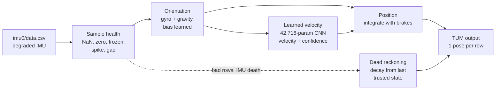

# Path Finder

**6-DoF trajectory from a degraded IMU alone, in 3.75 MiB of memory and 7.0 ms per second of data.**

Samsung PRISM XR Hackathon 2026 · Track 3: *Path Finder, Trajectory Estimation Under Sensor Degradation*
Team **California Burrito** · SRM Institute of Science and Technology, Kattankulathur
Rehaan Ajani (lead) · Nikhil Solanki · Mayank Yadav · Debadrita Haldar

[](https://github.com/rehaanajani/pathfinder-xr/actions/workflows/track3.yml)

## Submission

| Item | Where |
|---|---|
| **Source code** | [`src/main.py`](src/main.py): Python, network weights embedded; needs only Python 3 and numpy |
| **Presentation** | **[Google Slides](https://docs.google.com/presentation/d/1UhfNcmeuGhQjBOyQcsvGrlvwcIb-xog0/edit?usp=sharing)** · [`deck/SRMIST_CaliforniaBurrito.pptx`](deck/SRMIST_CaliforniaBurrito.pptx) (Samsung's template) |
| **Video** (2.5 min, narrated) | **[Google Drive](https://drive.google.com/file/d/1fMtWITCb1RfrTKooN9tEU_daj5p_4nbL/view?usp=sharing)** · [`docs/media/PathFinder_Track3.mp4`](docs/media/PathFinder_Track3.mp4) |
| **AI disclosure** | [`AI_DISCLOSURE.md`](AI_DISCLOSURE.md) |
| **README** | this page |
| Output | `estimated_trajectory.txt`, TUM format, exactly one pose per input IMU row |
| Benchmark reports | [`docs/reports/`](docs/reports/README.md): Windows laptop, MacBook, Galaxy phone |

## Install and run

```bash
git clone https://github.com/rehaanajani/pathfinder-xr.git
cd pathfinder-xr
pip install numpy
python3 src/main.py path/to/imu0_folder -o estimated_trajectory.txt
```

Needs only Python 3 and numpy; `src/main.py` is self-contained and can be copied anywhere on its own. **Input:** a folder with `imu0/data.csv` (or
`mav0/imu0/data.csv`), a `.zip` of it, or the CSV itself. Both column orders are detected (EuRoC
`timestamp, gyro, accel` and the organisers' `timestamp, accel, gyro`), as are timestamps in s/ms/µs/ns and
acceleration in m/s² or g; it prints what it found. **Output:** `timestamp tx ty tz qx qy qz qw`, one pose per input
row, including the rows after the IMU dies. Options: `python3 src/main.py --help` and [`src/README.md`](src/README.md).

With Docker (the image contains only `main.py`):

```bash
docker build -t pathfinder src/
docker run --rm -v "$PWD/data:/data" pathfinder /data -o /data/estimated_trajectory.txt
```

## The problem

Every XR headset and phone tracks motion with an IMU. Track 3 jams that IMU: noise and bias drift rise over time,
readings spike, freeze, duplicate and drop out, and finally the sensor dies. The entry must still output a 6-DoF
pose for every input row, including 5 s after the IMU dies, using **only** that IMU stream, in **8 MB** and
**20 ms per second of data**, on one CPU thread.

Integrating the damaged signal as it is fails completely: on EuRoC MH_05 damaged by the organisers' own script, plain
integration is **72 km** off after 113 s.

## Results

All numbers are measured, with the raw files linked. Accuracy uses the **organisers' own degradation script**
(`degrade_imu.py`, their seed, their documented accel-first columns), SE(3)-aligned like evo; what each metric
measures is in [`results/track3/README.md`](results/track3/README.md#current-results-organisers-degradation-script).

**All 17 public recordings (11 EuRoC + 6 TUM-VI), metres, lower is better:**

| | ATE | Checkpoints | Blind 5 s | Dropouts | Drift over 1 s |
|---|---:|---:|---:|---:|---:|
| Standing still | 2.62 | 2.45 | 2.28 | 2.42 | 0.77 |
| **Path Finder** | **2.31** | **2.13** | **2.24** | **2.13** | **0.57** |
| Improvement | **~12 %** | **~13 %** | **~2 %** | **~12 %** | **~26 %** |

- **Better on every one of the 17 recordings** for ATE, checkpoints, dropouts and drift
  ([`per_recording.md`](results/track3/per_recording.md), raw:
  [`organiser_per_recording.json`](results/track3/organiser_per_recording.json)).
- **Never trained on** (MH_05, V2_03, room6): ATE **3.10 m vs 3.31 m**, checkpoints 2.90 vs 3.03, dropouts 2.93 vs
  3.14, drift 0.70 vs 0.79.
- **XR headsets** (8 Monado recordings, IMU mounted unlike any training data): **0.57 m vs 0.83 m**, better on 8 / 8,
  thanks to the mount guard.

<sub>Per recording: better on 17 / 17 for ATE, checkpoints, dropouts and drift; the blind 5 s is better on average
and on 12 / 17.</sub>

**Resources** (worst of 5 recordings with the organisers' damage, MacBook Air M5,
Python 3.11; [`python_budget.json`](results/track3/python_budget.json), `tools/measure_python_budget.py`):

| | Measured | Budget |
|---|---:|---:|
| Peak heap of the algorithm (tracemalloc: data structures, buffers, estimation; the interpreter and numpy excluded) | **1.32 MiB** | 8 MB |
| Same, also counting `main.py` itself with its embedded network | **3.75 MiB** | 8 MB |
| CPU per second of IMU, one thread | **7.0 ms** | 20 ms |

**Same algorithm in C++** (`src/main.cpp`, output within 1 µm of `main.py`) for on-device use:

| Machine | Peak memory (process) | CPU per second of IMU | Report |
|---|---:|---:|---|
| MacBook Air, Apple M5 | 2.5 MB | 1.8 ms | [02](docs/reports/02_macbook.md) |
| Samsung Galaxy M36 phone CPU (Exynos 1380) | 4.0 MB | 5.0 ms | [03](docs/reports/03_phone.md) |
| Windows laptop, i7-11800H under WSL | 5.1 MB | 14.0 ms | [01](docs/reports/01_windows_laptop.md) |

## How it works



1. **Check every sample.** NaN/inf, all-zero, frozen (bit-identical repeats), physically impossible values and time
   gaps are caught row by row. Duplicated and out-of-order rows are handled.
2. **Start blind.** Gravity direction and gyro bias come from the data (the first still stretch); no ground truth,
   no calibration.
3. **Physics with brakes.** Strapdown integration with gravity correction, zero-velocity updates when still, a soft
   speed limit and a gentle pull back to the start point so drift cannot run away.
4. **Learned velocity.** A small 1-D CNN reads 1 s of body-frame IMU (AirIO style) and predicts velocity and its own
   uncertainty; the filter weights it by that uncertainty. Its weights are embedded in `main.py`. If the IMU is
   mounted unlike the training data, a mount guard switches to a gravity-aligned network
   ([`docs/MOUNT_GUARD.md`](docs/MOUNT_GUARD.md)).
5. **Coast when blind.** Through dropouts and the 5 s after the IMU dies, turn rate and speed decay from the last
   trusted state.

Design notes: [`docs/AIRIO.md`](docs/AIRIO.md) (network), [`docs/LEARNED_VELOCITY.md`](docs/LEARNED_VELOCITY.md),
[`docs/TRACK3_BRIEF.md`](docs/TRACK3_BRIEF.md) (the brief), [`docs/TRACK3_STATUS.md`](docs/TRACK3_STATUS.md).

## Proof

| Claim | Evidence |
|---|---|
| Accuracy on the organisers' script | [`per_recording.md`](results/track3/per_recording.md), [`organiser_per_recording.json`](results/track3/organiser_per_recording.json), and the same scores from `main.py` itself in [`organiser_per_recording_main_py.json`](results/track3/organiser_per_recording_main_py.json); reproduce with `tools/eval_organiser.py --script <degrade_imu.py> --data euroc:MH_05_difficult ...` |
| Memory and CPU of `main.py` | [`python_budget.json`](results/track3/python_budget.json); `tools/measure_python_budget.py` |
| `main.py` runs on its own | `tests/stress/test_standalone.py`: copied alone into an empty folder, identical output; embedded weights byte-identical to `src/velnet_weights*.bin` |
| One pose per row through every fault | CI on every push (badge above): stress tests, Docker image run |
| Rotated IMU handled | [`mount_guard_check.json`](results/track3/mount_guard_check.json); CI flips the IMU inside Docker |
| Every alternative was measured | [`retrain_organiser.md`](results/track3/retrain_organiser.md) (retraining on the organisers' damage, a 4× larger network, a 2 s window), [`coupling_sweep.md`](results/track3/coupling_sweep.md) (9 settings × 25 recordings), [`docs/RESEARCH_REVIEW.md`](docs/RESEARCH_REVIEW.md) |
| C++ port on three machines | [`docs/reports/`](docs/reports/README.md), [`phone_SM-M366B.json`](results/reports/phone_SM-M366B.json) |

## Tests

```bash
python -m pytest -q tests/stress                  # main.py
make -C src && PF_ENTRY=cpp python -m pytest -q tests/stress     # the C++ port
```

| Suite | What it checks |
|---|---|
| `test_main_contract.py` | one pose per row; header variants, trailing lines, NaN/inf, zero, frozen, missing, duplicate and out-of-order rows; truncated and tiny files; rotated gravity; budgets |
| `test_layout.py` | both column orders, timestamps in s/ms/µs/ns (including jittered 1 kHz ns), acceleration in g |
| `test_review_fixes.py` | regressions from independent reviews: zero acceleration at start, start-up boundary, a 100,000-file zip, a 3 s gap |
| `test_mount_guard.py` | switching networks for an IMU mounted another way |
| `test_standalone.py` | `main.py` alone gives identical output; embedded weights match the weight files |

## Safeguards

- **Handles bad input**: every input row gets a finite pose and a unit quaternion, tested on NaN, zero, frozen,
  missing, duplicate and out-of-order rows, cut and tiny files, and a zip with 100,000 members.
- **Exactly one pose per input row**: nothing appended, nothing filled in between.
- **Streams the input** row by row: memory does not grow with the length of the recording.
- **Says what it assumed**: column order, units and network choice are printed on stderr; flags override them.
- **Settings chosen to generalise**: the default beats standing still on all 17 recordings; settings that scored
  higher on some recordings but not on all of them were rejected.

## Design choices

- **Bounded drift by design.** An IMU alone cannot observe absolute heading or position, so Path Finder pulls its
  estimate gently back toward the start and weights the network by its own confidence. That keeps its ATE below
  standing still on every recording, from small rooms to 20 m drone flights.
- **Room to grow.** Given ground-truth velocity in place of the network, the same filter reaches 2.56 m on our
  validation recordings, and 1.95 m with a gentler pull to the start (our own damage model;
  [`retrain_organiser.md`](results/track3/retrain_organiser.md)). A better velocity network is the next lever, and
  the pipeline to retrain and re-score in minutes is already in `tools/`.
- **Clean evaluation.** 11 of the 17 recordings trained the network; the 3 it never saw are reported separately, and
  they were also among the recordings used to choose the filter settings.

## Beyond the scored task

The same ideas on real hardware, with cameras and several IMUs:

- **Live Galaxy phone demo**: the phone streams its IMU and camera tracking to a laptop dashboard; with the camera
  covered, Path Finder keeps tracking and reports its own uncertainty ([`docs/reports/03_phone.md`](docs/reports/03_phone.md)).
- **On a phone's own CPU**: the C++ port runs at 4.0 MB and 5.0 ms per second of data on a Galaxy M36.
- **Real VR headsets**: IMU clipping on Samsung Odyssey+ and Valve Index recordings, spotted from the data itself.
- **Several IMUs**: sensors on one rigid frame must agree; a biased, stuck or spiking one is voted out.

These live in [`demo_line/`](demo_line/README.md) and [`docs/WIDER_SYSTEM.md`](docs/WIDER_SYSTEM.md).

## Repository map

| Path | What |
|---|---|
| `src/main.py` | **the entry** (weights embedded) |
| `src/main.cpp` | the same algorithm in C++ for on-device use; `src/velnet_weights*.bin` are its weight files |
| `tests/stress/` | entry tests (run in CI) |
| `tools/` | evaluation (`eval_organiser.py`, `score_track3.py`), budgets (`measure_python_budget.py`), training (`train_airio.py`), weights embedding (`embed_weights.py`), phone benchmark (`android/`), video (`video/`) |
| `results/` | raw results behind every number |
| `docs/` | brief, design notes, benchmark reports, the wider camera system |
| `deck/` | the presentation and the script that builds it from measured numbers |
| `demo_line/` | live phone demo and multi-sensor work, beyond the scored task |

## Team

Rehaan Ajani (lead) · Nikhil Solanki · Mayank Yadav · Debadrita Haldar
SRM Institute of Science and Technology, Kattankulathur

AI tools were used as coding and review assistants; see [`AI_DISCLOSURE.md`](AI_DISCLOSURE.md).
