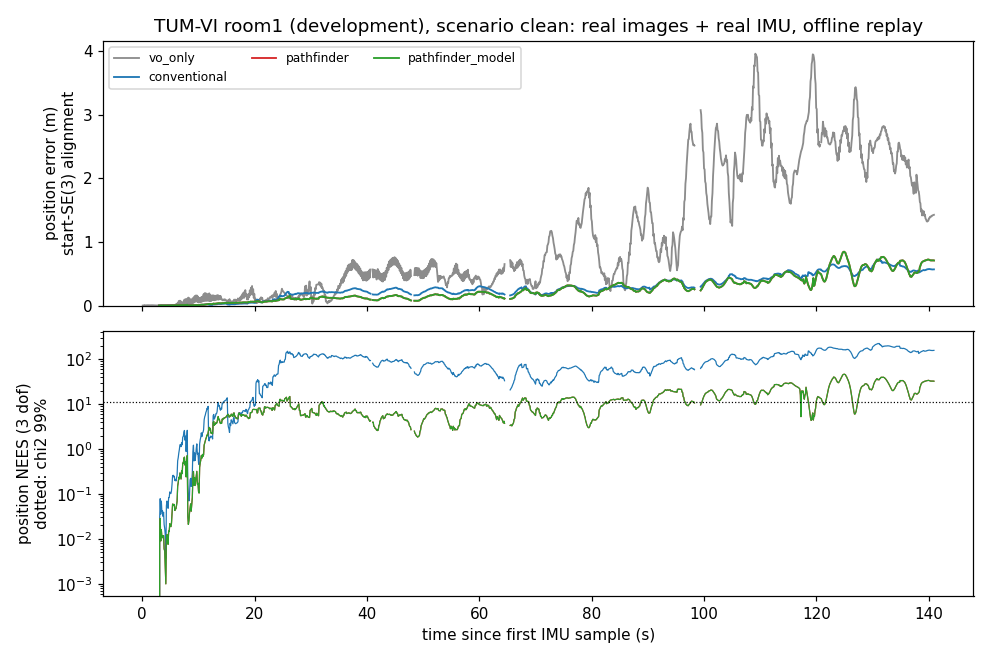
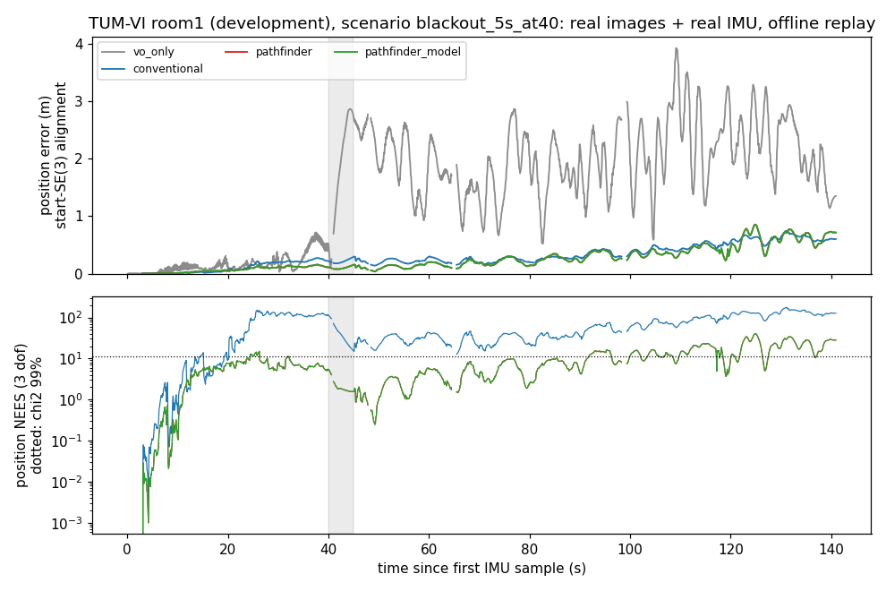
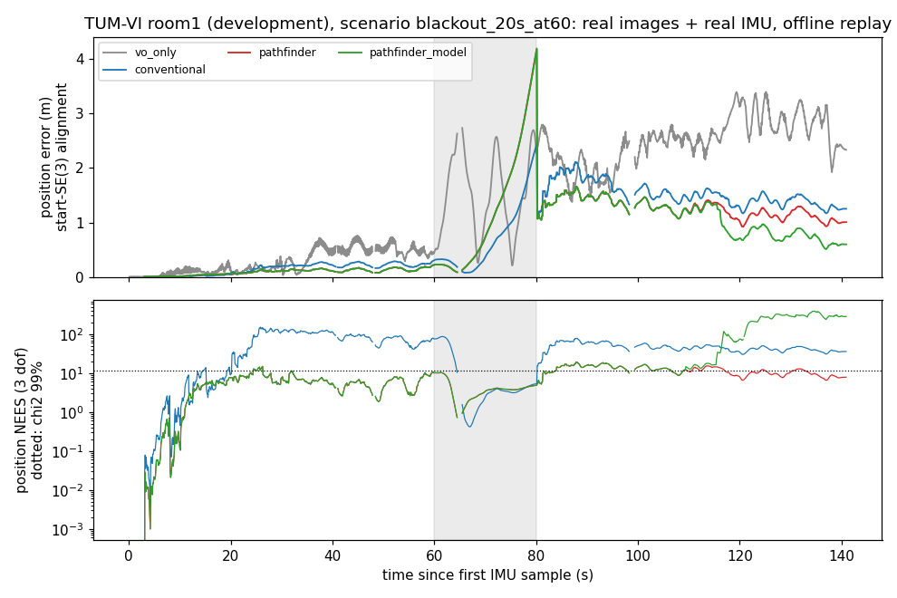
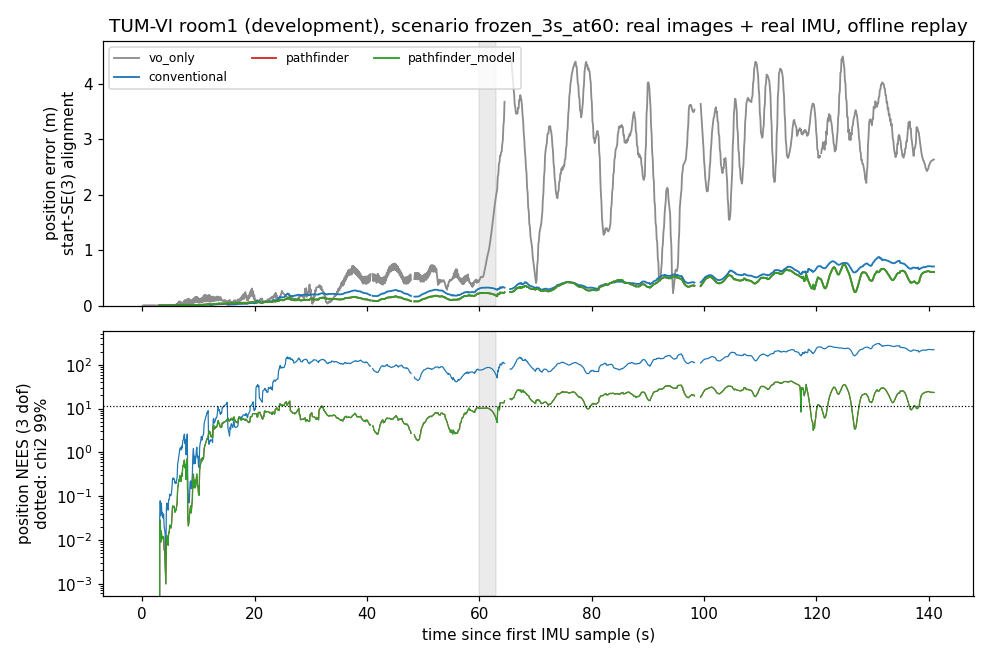
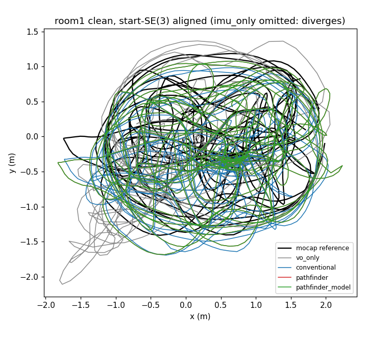
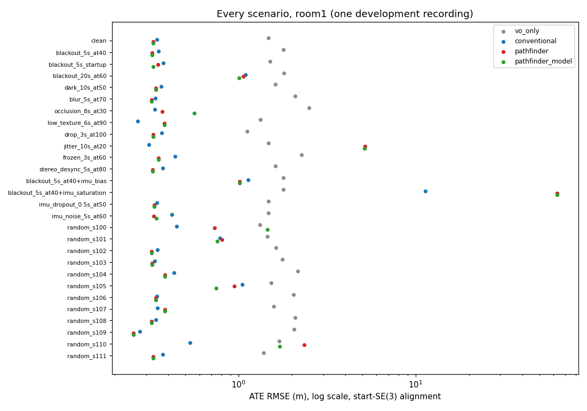

# Real-vision evaluation: room1 (pathfinder.vision-protocol/2)

**Generated by `tools/vision_report.py` from run `20261115T173827Z-vision-room1-c7acccf` (status: complete).** Real stereo images and the real single IMU of TUM-VI room1, replayed offline; faults are injected into images/IMU *before* the front end/estimator. No system receives the reference; no system is started from it. room1 is a **development** recording (see `data/exposure.json`): these are integration and development results on one recording, not an untouched final test and not evidence of general superiority.

## Frozen configuration

- VO covariance scale 4.0 and keyframe interval 4 (selected on room1 0–60 s, calibration run `20261115T173222Z-calibrate-vo-room1-6e9cb45-dirty`)
- IMU noise from the dataset's `imu_config.yaml`: {"sigma_g": 0.00016, "sigma_a": 0.0028, "sigma_bg": 2.2e-05, "sigma_ba": 0.00086}
- camera–IMU time offset applied: 0.0 s (measured 0.00017 s; protocol applies it only if > 1 ms)
- learned model: `models/dispnet_faults/best.pt` sha256 `611e97fdad4ac7735a3086179e059edb772f6d93d13a40c3b88b8d4bfec3eba3` (trained on TLIO headset data: cross-device here)
- initialisation: reference-free gravity start for every filter (odometry frame = start pose, velocity unknown)
- scoring: start-SE(3) alignment at the first initialised estimate (primary; drift fully visible), 4-DoF full-trajectory fit (secondary); never re-aligned per outage; mocap gaps > 50 ms excluded
- validity: VO covariance is not validated on held-out data, so every relative-mode output is `COVARIANCE_UNRELIABLE` and `valid=False` by contract; errors below are over **all estimated** samples

## Main results (ATE RMSE, m; all estimated samples)

| scenario | vo_only | imu_only | conventional | pathfinder | pathfinder_model |
|---|---|---|---|---|---|
| clean | 1.470 | 218.693 | 0.344 | 0.328 | 0.328 |
| blackout_5s_at40 | 1.789 | 218.693 | 0.351 | 0.325 | 0.325 |
| blackout_5s_startup | 1.499 | 218.693 | 0.375 | 0.349 | 0.328 |
| blackout_20s_at60 | 1.798 | 218.693 | 1.091 | 1.064 | 1.003 |
| dark_10s_at50 | 1.613 | 218.693 | 0.365 | 0.339 | 0.339 |
| blur_5s_at70 | 2.076 | 218.693 | 0.338 | 0.322 | 0.322 |
| occlusion_8s_at30 | 2.501 | 218.693 | 0.337 | 0.369 | 0.561 |
| low_texture_6s_at90 | 1.324 | 218.693 | 0.269 | 0.380 | 0.380 |
| drop_3s_at100 | 1.117 | 218.693 | 0.367 | 0.329 | 0.329 |
| jitter_10s_at20 | 1.470 | 218.693 | 0.311 | 5.168 | 5.147 |
| frozen_3s_at60 | 2.271 | 218.693 | 0.437 | 0.352 | 0.352 |
| stereo_desync_5s_at80 | 1.609 | 218.693 | 0.372 | 0.326 | 0.326 |
| blackout_5s_at40+imu_bias | 1.789 | 1209.522 | 1.129 | 1.013 | 1.014 |
| blackout_5s_at40+imu_saturation | 1.789 | 6701.866 | 11.368 | 62.862 | 62.862 |
| imu_dropout_0.5s_at50 | 1.470 | 1415.253 | 0.345 | 0.332 | 0.332 |
| imu_noise_5s_at60 | 1.470 | 194.691 | 0.420 | 0.330 | 0.342 |
| random_s100 | 1.318 | 1207.081 | 0.447 | 0.729 | 1.448 |
| random_s101 | 1.450 | 2889.988 | 0.784 | 0.804 | 0.758 |
| random_s102 | 1.625 | 218.693 | 0.347 | 0.322 | 0.322 |
| random_s103 | 1.766 | 218.693 | 0.335 | 0.323 | 0.323 |
| random_s104 | 2.158 | 218.693 | 0.430 | 0.384 | 0.384 |
| random_s105 | 1.525 | 5757.266 | 1.049 | 0.947 | 0.746 |
| random_s106 | 2.041 | 218.693 | 0.346 | 0.341 | 0.341 |
| random_s107 | 1.580 | 218.693 | 0.348 | 0.384 | 0.384 |
| random_s108 | 2.083 | 218.693 | 0.341 | 0.322 | 0.322 |
| random_s109 | 2.052 | 218.693 | 0.277 | 0.254 | 0.254 |
| random_s110 | 1.688 | 1801.912 | 0.530 | 2.348 | 1.708 |
| random_s111 | 1.384 | 218.693 | 0.372 | 0.329 | 0.329 |

## Paired scenario-level deltas (negative = first system better)

| a vs b | n | median Δ m | mean Δ m | a better | b better | bootstrap 95% of median | worst case for a |
|---|---|---|---|---|---|---|---|
| pathfinder vs conventional | 28 | -0.021 | 2.066 | 20 | 8 | [-0.026, -0.009] | blackout_5s_at40+imu_saturation (51.494) |
| pathfinder vs vo_only | 28 | -1.146 | 1.212 | 25 | 3 | [-1.373, -0.866] | blackout_5s_at40+imu_saturation (61.073) |
| pathfinder_model vs pathfinder | 28 | 0.000 | -0.002 | 6 | 4 | [0.000, 0.000] | random_s100 (0.719) |
| pathfinder_no_gate vs pathfinder | 28 | 0.038 | -1.987 | 9 | 19 | [0.003, 0.047] | imu_noise_5s_at60 (0.184) |
| pathfinder_uncal_cov vs pathfinder | 28 | 2.481 | 2.908 | 1 | 27 | [1.604, 2.710] | random_s101 (9.736) |
| pathfinder_no_adaptive_q vs pathfinder | 28 | 0.000 | 0.000 | 0 | 0 | [0.000, 0.000] | clean (0.000) |
| pathfinder_no_health vs pathfinder | 28 | 0.000 | -0.000 | 9 | 18 | [-0.000, 0.000] | blackout_20s_at60 (0.001) |
| pathfinder_model_no_selfcheck vs pathfinder_model | 28 | 0.399 | 0.314 | 4 | 24 | [0.303, 0.455] | jitter_10s_at20 (1.506) |
| pathfinder_model_biascorr vs pathfinder_model | 28 | 0.000 | -0.000 | 5 | 5 | [0.000, 0.000] | random_s100 (0.028) |

Intervals resample scenarios on one recording (fault-schedule variability), not recordings.

## Clean run detail

| system | ATE | max err | 4-DoF ATE | rot RMSE deg | RPE 1 s m | RPE 1 s deg | final drift % path | held-out 60–141 s ATE | NEES≤χ²99% (all) | VO used/rejected |
|---|---|---|---|---|---|---|---|---|---|---|
| vo_only | 1.470 | 3.961 | 1.229 | 72.21 | 0.238 | 16.53 | 0.97 | 1.921 | – | –/– |
| imu_only | 218.693 | 498.057 | 147.877 | 1.48 | 4.275 | 0.54 | 339.62 | 284.541 | 1.00 | 0/0 |
| conventional | 0.344 | 0.728 | 0.197 | 2.73 | 0.034 | 0.69 | 0.39 | 0.425 | 0.12 | 687/0 |
| pathfinder | 0.328 | 0.846 | 0.315 | 6.22 | 0.066 | 2.03 | 0.48 | 0.420 | 0.60 | 627/58 |
| pathfinder_no_gate | 0.364 | 0.779 | 0.213 | 2.82 | 0.035 | 0.69 | 0.42 | 0.454 | 0.22 | 685/0 |
| pathfinder_uncal_cov | 2.885 | 9.390 | 2.574 | 9.35 | 0.339 | 2.51 | 6.19 | 3.765 | 0.12 | 370/315 |
| pathfinder_no_adaptive_q | 0.328 | 0.846 | 0.315 | 6.22 | 0.066 | 2.03 | 0.48 | 0.420 | 0.60 | 627/58 |
| pathfinder_no_health | 0.328 | 0.851 | 0.316 | 6.23 | 0.066 | 2.03 | 0.48 | 0.420 | 0.60 | 629/58 |
| pathfinder_model | 0.328 | 0.846 | 0.315 | 6.22 | 0.066 | 2.03 | 0.48 | 0.420 | 0.60 | 627/58 |
| pathfinder_model_no_selfcheck | 0.711 | 1.406 | 0.447 | 7.50 | 0.065 | 1.55 | 0.82 | 0.915 | 0.16 | 628/57 |
| pathfinder_model_biascorr | 0.328 | 0.846 | 0.315 | 6.22 | 0.066 | 2.03 | 0.48 | 0.420 | 0.60 | 627/58 |

## Outage / fault behaviour (Path Finder, conventional, VO only)

Recovery: first time after the fault ends from which the error stays ≤ (error at fault start + 0.10 m) for 2 s; '–' = never within the recording. Step deviation: largest per-sample position step beyond the reference's own step within 2 s after the fault (re-anchoring discontinuity).

| scenario | fault | system | error growth m | error at end m | recovery s | step dev m | NEES≤χ²99% inside |
|---|---|---|---|---|---|---|---|
| blackout_20s_at60 | image:blackout 60.0–80.0 s | vo_only | 1.934 | 2.381 | – | 0.3290 | – |
| blackout_20s_at60 | image:blackout 60.0–80.0 s | conventional | 2.090 | 2.394 | – | 3.1184 | 0.77 |
| blackout_20s_at60 | image:blackout 60.0–80.0 s | pathfinder | 3.896 | 4.115 | – | 4.8139 | 1.00 |
| blackout_20s_at60 | image:blackout 60.0–80.0 s | pathfinder_model | 3.896 | 4.115 | – | 4.8139 | 1.00 |
| drop_3s_at100 | image:drop 100.0–103.0 s | vo_only | 0.274 | 2.431 | 0.2 | 0.4189 | – |
| drop_3s_at100 | image:drop 100.0–103.0 s | conventional | -0.072 | 0.285 | 4.3 | 0.1011 | 0.00 |
| drop_3s_at100 | image:drop 100.0–103.0 s | pathfinder | -0.065 | 0.263 | 0.0 | 0.0597 | 0.34 |
| drop_3s_at100 | image:drop 100.0–103.0 s | pathfinder_model | -0.065 | 0.263 | 0.0 | 0.0597 | 0.34 |
| blackout_5s_at40+imu_bias | image:blackout 40.0–45.0 s | vo_only | 2.183 | 2.738 | – | 0.2492 | – |
| blackout_5s_at40+imu_bias | imu:bias 35.0–142.1 s | vo_only | – | – | – | – | – |
| blackout_5s_at40+imu_bias | image:blackout 40.0–45.0 s | conventional | 6.321 | 6.426 | – | 4.7493 | 0.00 |
| blackout_5s_at40+imu_bias | imu:bias 35.0–142.1 s | conventional | – | – | – | – | 0.00 |
| blackout_5s_at40+imu_bias | image:blackout 40.0–45.0 s | pathfinder | 1.422 | 2.518 | 0.4 | 1.4821 | 0.00 |
| blackout_5s_at40+imu_bias | imu:bias 35.0–142.1 s | pathfinder | – | – | – | – | 0.01 |
| blackout_5s_at40+imu_bias | image:blackout 40.0–45.0 s | pathfinder_model | 1.422 | 2.518 | 0.4 | 1.4821 | 0.00 |
| blackout_5s_at40+imu_bias | imu:bias 35.0–142.1 s | pathfinder_model | – | – | – | – | 0.01 |
| blackout_5s_at40 | image:blackout 40.0–45.0 s | vo_only | 2.183 | 2.738 | – | 0.2492 | – |
| blackout_5s_at40 | image:blackout 40.0–45.0 s | conventional | 0.074 | 0.292 | 0.0 | 0.1170 | 0.00 |
| blackout_5s_at40 | image:blackout 40.0–45.0 s | pathfinder | 0.041 | 0.152 | 0.0 | 0.0937 | 1.00 |
| blackout_5s_at40 | image:blackout 40.0–45.0 s | pathfinder_model | 0.041 | 0.152 | 0.0 | 0.0937 | 1.00 |
| jitter_10s_at20 | image:jitter 20.0–30.0 s | vo_only | 0.229 | 0.296 | – | 0.3091 | – |
| jitter_10s_at20 | image:jitter 20.0–30.0 s | conventional | 0.249 | 0.294 | – | 0.0623 | 0.06 |
| jitter_10s_at20 | image:jitter 20.0–30.0 s | pathfinder | 4.798 | 4.860 | – | 0.4597 | 0.17 |
| jitter_10s_at20 | image:jitter 20.0–30.0 s | pathfinder_model | 4.798 | 4.860 | – | 0.4597 | 0.17 |
| stereo_desync_5s_at80 | image:stereo_desync 80.0–85.0 s | vo_only | 1.730 | 3.075 | – | 0.2707 | – |
| stereo_desync_5s_at80 | image:stereo_desync 80.0–85.0 s | conventional | 0.365 | 0.578 | – | 0.2597 | 0.00 |
| stereo_desync_5s_at80 | image:stereo_desync 80.0–85.0 s | pathfinder | 0.133 | 0.285 | 1.0 | 0.1613 | 1.00 |
| stereo_desync_5s_at80 | image:stereo_desync 80.0–85.0 s | pathfinder_model | 0.133 | 0.285 | 1.0 | 0.1613 | 1.00 |
| blackout_5s_at40+imu_saturation | image:blackout 40.0–45.0 s | vo_only | 2.183 | 2.738 | – | 0.2492 | – |
| blackout_5s_at40+imu_saturation | imu:saturation 40.0–45.0 s | vo_only | 2.183 | 2.738 | – | 0.2492 | – |
| blackout_5s_at40+imu_saturation | image:blackout 40.0–45.0 s | conventional | 20.812 | 21.030 | – | 27.7704 | 0.00 |
| blackout_5s_at40+imu_saturation | imu:saturation 40.0–45.0 s | conventional | 20.812 | 21.030 | – | 27.7704 | 0.00 |
| blackout_5s_at40+imu_saturation | image:blackout 40.0–45.0 s | pathfinder | 20.824 | 20.936 | – | 0.1062 | 0.13 |
| blackout_5s_at40+imu_saturation | imu:saturation 40.0–45.0 s | pathfinder | 20.824 | 20.936 | – | 0.1062 | 0.13 |
| blackout_5s_at40+imu_saturation | image:blackout 40.0–45.0 s | pathfinder_model | 20.824 | 20.936 | – | 0.1062 | 0.13 |
| blackout_5s_at40+imu_saturation | imu:saturation 40.0–45.0 s | pathfinder_model | 20.824 | 20.936 | – | 0.1062 | 0.13 |
| frozen_3s_at60 | image:frozen 60.0–63.0 s | vo_only | 1.535 | 1.983 | – | 0.2444 | – |
| frozen_3s_at60 | image:frozen 60.0–63.0 s | conventional | -0.012 | 0.292 | 5.4 | 0.0648 | 0.00 |
| frozen_3s_at60 | image:frozen 60.0–63.0 s | pathfinder | -0.039 | 0.180 | 5.9 | 0.0708 | 1.00 |
| frozen_3s_at60 | image:frozen 60.0–63.0 s | pathfinder_model | -0.039 | 0.180 | 5.9 | 0.0708 | 1.00 |
| occlusion_8s_at30 | image:occlusion 30.0–38.0 s | vo_only | 0.908 | 1.203 | – | 0.2710 | – |
| occlusion_8s_at30 | image:occlusion 30.0–38.0 s | conventional | 0.686 | 0.885 | 3.1 | 1.2162 | 0.14 |
| occlusion_8s_at30 | image:occlusion 30.0–38.0 s | pathfinder | 1.073 | 1.192 | 0.2 | 1.1949 | 1.00 |
| occlusion_8s_at30 | image:occlusion 30.0–38.0 s | pathfinder_model | 1.073 | 1.192 | 0.2 | 1.1949 | 1.00 |
| blur_5s_at70 | image:blur 70.0–75.0 s | vo_only | 1.108 | 1.477 | – | 0.2248 | – |
| blur_5s_at70 | image:blur 70.0–75.0 s | conventional | 0.035 | 0.209 | 0.0 | 0.0188 | 0.12 |
| blur_5s_at70 | image:blur 70.0–75.0 s | pathfinder | 0.038 | 0.222 | 0.0 | 0.0461 | 0.97 |
| blur_5s_at70 | image:blur 70.0–75.0 s | pathfinder_model | 0.038 | 0.222 | 0.0 | 0.0461 | 0.97 |
| blackout_5s_startup | image:blackout 0.0–5.0 s | vo_only | – | – | – | 0.1347 | – |
| blackout_5s_startup | image:blackout 0.0–5.0 s | conventional | – | 0.269 | 9.2 | 0.8792 | 1.00 |
| blackout_5s_startup | image:blackout 0.0–5.0 s | pathfinder | – | 0.269 | 9.6 | 0.8571 | 1.00 |
| blackout_5s_startup | image:blackout 0.0–5.0 s | pathfinder_model | – | 0.013 | 0.0 | 0.0087 | 1.00 |
| dark_10s_at50 | image:dark 50.0–60.0 s | vo_only | 0.389 | 0.768 | – | 0.2361 | – |
| dark_10s_at50 | image:dark 50.0–60.0 s | conventional | 0.164 | 0.373 | 1.9 | 0.0435 | 0.00 |
| dark_10s_at50 | image:dark 50.0–60.0 s | pathfinder | 0.164 | 0.279 | 19.0 | 0.0226 | 0.94 |
| dark_10s_at50 | image:dark 50.0–60.0 s | pathfinder_model | 0.164 | 0.279 | 19.0 | 0.0226 | 0.94 |
| low_texture_6s_at90 | image:low_texture 90.0–96.0 s | vo_only | -0.043 | 1.809 | 8.5 | 0.3652 | – |
| low_texture_6s_at90 | image:low_texture 90.0–96.0 s | conventional | 0.351 | 0.628 | 0.2 | 0.3676 | 0.00 |
| low_texture_6s_at90 | image:low_texture 90.0–96.0 s | pathfinder | -0.004 | 0.204 | 0.0 | 0.1458 | 0.79 |
| low_texture_6s_at90 | image:low_texture 90.0–96.0 s | pathfinder_model | -0.004 | 0.204 | 0.0 | 0.1458 | 0.79 |
| imu_dropout_0.5s_at50 | imu:dropout 50.0–50.5 s | vo_only | 0.149 | 0.528 | 8.9 | 0.2679 | – |
| imu_dropout_0.5s_at50 | imu:dropout 50.0–50.5 s | conventional | 0.032 | 0.240 | 0.0 | 0.0508 | 0.31 |
| imu_dropout_0.5s_at50 | imu:dropout 50.0–50.5 s | pathfinder | 0.031 | 0.146 | 0.0 | 0.0513 | 1.00 |
| imu_dropout_0.5s_at50 | imu:dropout 50.0–50.5 s | pathfinder_model | 0.031 | 0.146 | 0.0 | 0.0513 | 1.00 |
| imu_noise_5s_at60 | imu:noise 60.0–65.0 s | vo_only | – | – | 2.9 | 0.2593 | – |
| imu_noise_5s_at60 | imu:noise 60.0–65.0 s | conventional | – | – | 0.4 | 0.0427 | 0.00 |
| imu_noise_5s_at60 | imu:noise 60.0–65.0 s | pathfinder | – | – | 0.4 | 0.2570 | 1.00 |
| imu_noise_5s_at60 | imu:noise 60.0–65.0 s | pathfinder_model | – | – | 0.4 | 0.2570 | 1.00 |
| random_s100 | image:frozen 5.9–8.9 s | vo_only | -0.005 | 0.014 | – | 0.8012 | – |
| random_s100 | image:drop 82.8–92.3 s | vo_only | 0.174 | 0.623 | – | 0.3305 | – |
| random_s100 | image:stereo_desync 93.4–98.7 s | vo_only | – | – | – | 0.5054 | – |
| random_s100 | imu:spikes 10.9–14.0 s | vo_only | 0.051 | 0.160 | 0.0 | 0.2381 | – |
| random_s100 | image:frozen 5.9–8.9 s | conventional | 0.010 | 0.012 | 0.0 | 0.0355 | 1.00 |
| random_s100 | image:drop 82.8–92.3 s | conventional | 0.288 | 0.642 | 0.2 | 0.4148 | 0.22 |
| random_s100 | image:stereo_desync 93.4–98.7 s | conventional | – | – | – | 0.1053 | 0.00 |
| random_s100 | imu:spikes 10.9–14.0 s | conventional | 0.191 | 0.199 | – | 0.1144 | 0.08 |
| random_s100 | image:frozen 5.9–8.9 s | pathfinder | 0.010 | 0.012 | 0.0 | 0.0400 | 1.00 |
| random_s100 | image:drop 82.8–92.3 s | pathfinder | 0.582 | 1.091 | 0.2 | 0.5568 | 1.00 |
| random_s100 | image:stereo_desync 93.4–98.7 s | pathfinder | – | – | – | 0.1047 | 0.90 |
| random_s100 | imu:spikes 10.9–14.0 s | pathfinder | 1.305 | 1.314 | – | 0.1973 | 0.11 |
| random_s100 | image:frozen 5.9–8.9 s | pathfinder_model | 0.446 | 0.448 | – | 0.0392 | 0.54 |
| random_s100 | image:drop 82.8–92.3 s | pathfinder_model | -0.505 | 1.083 | 0.0 | 0.5588 | 0.16 |
| random_s100 | image:stereo_desync 93.4–98.7 s | pathfinder_model | – | – | 0.7 | 0.1044 | 0.00 |
| random_s100 | imu:spikes 10.9–14.0 s | pathfinder_model | 0.277 | 1.511 | 75.3 | 0.2146 | 0.00 |
| random_s105 | image:drop 0.0–9.7 s | vo_only | – | – | – | 0.2391 | – |
| random_s105 | imu:dropout 72.7–79.0 s | vo_only | 0.574 | 1.747 | 1.1 | 0.2965 | – |
| random_s105 | image:drop 0.0–9.7 s | conventional | – | 1.529 | – | 6.2479 | 1.00 |
| random_s105 | imu:dropout 72.7–79.0 s | conventional | -0.027 | 0.610 | 0.0 | 0.1302 | 1.00 |
| random_s105 | image:drop 0.0–9.7 s | pathfinder | – | 1.529 | – | 3.9549 | 1.00 |
| random_s105 | imu:dropout 72.7–79.0 s | pathfinder | -0.045 | 0.782 | 0.0 | 0.1264 | 1.00 |
| random_s105 | image:drop 0.0–9.7 s | pathfinder_model | – | 0.540 | – | 0.2096 | 0.39 |
| random_s105 | imu:dropout 72.7–79.0 s | pathfinder_model | 0.173 | 0.978 | 0.7 | 0.1258 | 0.00 |
| random_s102 | image:blur 41.1–44.0 s | vo_only | -0.424 | 0.238 | 0.0 | 0.2361 | – |
| random_s102 | image:drop 132.9–140.1 s | vo_only | 0.141 | 2.907 | – | 0.4865 | – |
| random_s102 | image:blur 41.1–44.0 s | conventional | 0.083 | 0.257 | 1.4 | 0.0138 | 0.00 |
| random_s102 | image:drop 132.9–140.1 s | conventional | 0.137 | 0.784 | – | 0.1982 | 0.00 |
| random_s102 | image:blur 41.1–44.0 s | pathfinder | 0.063 | 0.149 | 0.0 | 0.0150 | 1.00 |
| random_s102 | image:drop 132.9–140.1 s | pathfinder | -0.104 | 0.538 | – | 0.6329 | 0.53 |
| random_s102 | image:blur 41.1–44.0 s | pathfinder_model | 0.063 | 0.149 | 0.0 | 0.0150 | 1.00 |
| random_s102 | image:drop 132.9–140.1 s | pathfinder_model | -0.104 | 0.538 | – | 0.6329 | 0.53 |
| random_s103 | image:blackout 98.1–99.3 s | vo_only | – | – | – | 0.5008 | – |
| random_s103 | image:blackout 120.5–121.5 s | vo_only | -0.248 | 2.674 | 4.0 | 0.3862 | – |
| random_s103 | image:blackout 98.1–99.3 s | conventional | – | – | 0.1 | 0.0518 | 0.00 |
| random_s103 | image:blackout 120.5–121.5 s | conventional | -0.003 | 0.551 | 0.0 | 0.0336 | 0.00 |
| random_s103 | image:blackout 98.1–99.3 s | pathfinder | – | – | 0.1 | 0.0582 | 0.75 |
| random_s103 | image:blackout 120.5–121.5 s | pathfinder | -0.192 | 0.315 | 4.5 | 0.2299 | 0.79 |
| random_s103 | image:blackout 98.1–99.3 s | pathfinder_model | – | – | 0.1 | 0.0582 | 0.75 |
| random_s103 | image:blackout 120.5–121.5 s | pathfinder_model | -0.192 | 0.315 | 4.5 | 0.2299 | 0.79 |
| random_s106 | image:blackout 44.9–46.3 s | vo_only | 0.142 | 0.902 | – | 0.2434 | – |
| random_s106 | image:stereo_desync 65.2–65.8 s | vo_only | – | 2.954 | – | 0.2589 | – |
| random_s106 | image:blackout 44.9–46.3 s | conventional | -0.014 | 0.265 | 2.1 | 0.0433 | 0.00 |
| random_s106 | image:stereo_desync 65.2–65.8 s | conventional | – | 0.168 | – | 0.0304 | 0.00 |
| random_s106 | image:blackout 44.9–46.3 s | pathfinder | -0.008 | 0.154 | 2.1 | 0.0379 | 1.00 |
| random_s106 | image:stereo_desync 65.2–65.8 s | pathfinder | – | 0.114 | – | 0.0264 | 1.00 |
| random_s106 | image:blackout 44.9–46.3 s | pathfinder_model | -0.008 | 0.154 | 2.1 | 0.0379 | 1.00 |
| random_s106 | image:stereo_desync 65.2–65.8 s | pathfinder_model | – | 0.114 | – | 0.0264 | 1.00 |
| random_s101 | image:stereo_desync 82.5–84.0 s | vo_only | 0.475 | 0.838 | – | 0.2640 | – |
| random_s101 | imu:saturation 28.5–30.8 s | vo_only | 0.112 | 0.270 | 1.7 | 0.3091 | – |
| random_s101 | image:stereo_desync 82.5–84.0 s | conventional | -0.114 | 0.811 | 0.0 | 0.1275 | 0.00 |
| random_s101 | imu:saturation 28.5–30.8 s | conventional | 0.765 | 0.953 | – | 0.4893 | 0.00 |
| random_s101 | image:stereo_desync 82.5–84.0 s | pathfinder | -0.282 | 0.442 | 0.0 | 0.0607 | 1.00 |
| random_s101 | imu:saturation 28.5–30.8 s | pathfinder | 1.117 | 1.212 | – | 0.1009 | 0.41 |
| random_s101 | image:stereo_desync 82.5–84.0 s | pathfinder_model | 0.328 | 0.883 | 2.8 | 0.0622 | 0.00 |
| random_s101 | imu:saturation 28.5–30.8 s | pathfinder_model | 1.117 | 1.212 | – | 0.1009 | 0.41 |
| random_s107 | image:drop 102.1–104.2 s | vo_only | 0.146 | 2.921 | 1.5 | 0.3877 | – |
| random_s107 | image:drop 102.1–104.2 s | conventional | 0.035 | 0.399 | 2.1 | 0.1233 | 0.00 |
| random_s107 | image:drop 102.1–104.2 s | pathfinder | 0.079 | 0.396 | 3.3 | 0.0949 | 0.00 |
| random_s107 | image:drop 102.1–104.2 s | pathfinder_model | 0.079 | 0.396 | 3.3 | 0.0949 | 0.00 |
| random_s108 | image:frozen 48.3–51.6 s | vo_only | – | 2.900 | – | 0.2774 | – |
| random_s108 | image:frozen 48.3–51.6 s | conventional | – | 0.222 | – | 0.0764 | 0.00 |
| random_s108 | image:frozen 48.3–51.6 s | pathfinder | – | 0.117 | – | 0.0487 | 1.00 |
| random_s108 | image:frozen 48.3–51.6 s | pathfinder_model | – | 0.117 | – | 0.0487 | 1.00 |
| random_s104 | image:frozen 17.2–21.2 s | vo_only | 1.274 | 1.357 | – | 0.1897 | – |
| random_s104 | image:blur 88.1–92.6 s | vo_only | -1.131 | 0.799 | 0.0 | 0.4034 | – |
| random_s104 | image:jitter 106.2–106.8 s | vo_only | -0.275 | 2.914 | 7.4 | 0.4759 | – |
| random_s104 | image:frozen 17.2–21.2 s | conventional | 0.066 | 0.094 | – | 0.2768 | 1.00 |
| random_s104 | image:blur 88.1–92.6 s | conventional | 0.139 | 0.465 | – | 0.0367 | 0.00 |
| random_s104 | image:jitter 106.2–106.8 s | conventional | -0.066 | 0.440 | 0.0 | 0.1406 | 0.00 |
| random_s104 | image:frozen 17.2–21.2 s | pathfinder | 0.038 | 0.084 | – | 0.2621 | 1.00 |
| random_s104 | image:blur 88.1–92.6 s | pathfinder | 0.201 | 0.578 | 25.9 | 0.0439 | 0.00 |
| random_s104 | image:jitter 106.2–106.8 s | pathfinder | 0.021 | 0.555 | 0.0 | 0.0408 | 0.00 |
| random_s104 | image:frozen 17.2–21.2 s | pathfinder_model | 0.038 | 0.084 | – | 0.2621 | 1.00 |
| random_s104 | image:blur 88.1–92.6 s | pathfinder_model | 0.201 | 0.578 | 25.9 | 0.0439 | 0.00 |
| random_s104 | image:jitter 106.2–106.8 s | pathfinder_model | 0.021 | 0.555 | 0.0 | 0.0408 | 0.00 |
| random_s110 | image:blackout 13.7–14.4 s | vo_only | 0.294 | 0.446 | 47.2 | 0.2408 | – |
| random_s110 | image:stereo_desync 69.7–72.0 s | vo_only | 1.194 | 1.851 | – | 0.2521 | – |
| random_s110 | imu:bias 26.7–29.6 s | vo_only | 0.084 | 0.639 | 2.7 | 0.3088 | – |
| random_s110 | image:blackout 13.7–14.4 s | conventional | -0.000 | 0.025 | 0.0 | 0.0174 | 1.00 |
| random_s110 | image:stereo_desync 69.7–72.0 s | conventional | -0.214 | 0.336 | 0.0 | 0.0769 | 0.00 |
| random_s110 | imu:bias 26.7–29.6 s | conventional | 0.271 | 0.438 | 48.9 | 0.3172 | 0.00 |
| random_s110 | image:blackout 13.7–14.4 s | pathfinder | 0.001 | 0.038 | 0.0 | 0.0178 | 1.00 |
| random_s110 | image:stereo_desync 69.7–72.0 s | pathfinder | 0.007 | 2.607 | 9.3 | 0.2046 | 0.00 |
| random_s110 | imu:bias 26.7–29.6 s | pathfinder | 0.481 | 0.576 | – | 0.0757 | 0.20 |
| random_s110 | image:blackout 13.7–14.4 s | pathfinder_model | 0.001 | 0.038 | 0.0 | 0.0178 | 1.00 |
| random_s110 | image:stereo_desync 69.7–72.0 s | pathfinder_model | -0.496 | 1.588 | 0.0 | 0.1813 | 0.00 |
| random_s110 | imu:bias 26.7–29.6 s | pathfinder_model | 0.481 | 0.576 | – | 0.0757 | 0.20 |
| random_s111 | image:jitter 33.5–38.9 s | vo_only | 0.377 | 0.440 | – | 0.2597 | – |
| random_s111 | image:blur 92.3–93.1 s | vo_only | 0.289 | 1.160 | – | 0.3963 | – |
| random_s111 | image:jitter 33.5–38.9 s | conventional | 0.060 | 0.270 | 2.0 | 0.0267 | 0.00 |
| random_s111 | image:blur 92.3–93.1 s | conventional | 0.006 | 0.434 | 0.0 | 0.0516 | 0.00 |
| random_s111 | image:jitter 33.5–38.9 s | pathfinder | -0.051 | 0.070 | 2.0 | 0.0518 | 1.00 |
| random_s111 | image:blur 92.3–93.1 s | pathfinder | -0.005 | 0.437 | 0.0 | 0.0542 | 0.00 |
| random_s111 | image:jitter 33.5–38.9 s | pathfinder_model | -0.051 | 0.070 | 2.0 | 0.0518 | 1.00 |
| random_s111 | image:blur 92.3–93.1 s | pathfinder_model | -0.005 | 0.437 | 0.0 | 0.0542 | 0.00 |
| random_s109 | image:low_texture 44.7–50.9 s | vo_only | 1.293 | 1.860 | – | 0.2788 | – |
| random_s109 | image:dark 76.1–76.9 s | vo_only | -0.507 | 2.864 | 0.0 | 0.2733 | – |
| random_s109 | image:low_texture 44.7–50.9 s | conventional | -0.070 | 0.203 | 0.0 | 0.0423 | 0.00 |
| random_s109 | image:dark 76.1–76.9 s | conventional | 0.006 | 0.259 | 0.0 | 0.0249 | 0.00 |
| random_s109 | image:low_texture 44.7–50.9 s | pathfinder | -0.047 | 0.108 | 0.0 | 0.0292 | 1.00 |
| random_s109 | image:dark 76.1–76.9 s | pathfinder | -0.019 | 0.231 | 0.0 | 0.0218 | 1.00 |
| random_s109 | image:low_texture 44.7–50.9 s | pathfinder_model | -0.047 | 0.108 | 0.0 | 0.0292 | 1.00 |
| random_s109 | image:dark 76.1–76.9 s | pathfinder_model | -0.019 | 0.231 | 0.0 | 0.0218 | 1.00 |

## Failures and harness errors

- none: every scenario × system produced scored output

## Runtime

- front end (decode + corrupt + VO), batch evaluation, clean room1: p50 68.1 ms, p95 219.9 ms, p99 276.4 ms per frame
- estimator `vo_only`: 25 µs per IMU sample (mean, offline replay incl. Python overhead)
- estimator `imu_only`: 2595 µs per IMU sample (mean, offline replay incl. Python overhead)
- estimator `conventional`: 3332 µs per IMU sample (mean, offline replay incl. Python overhead)
- estimator `pathfinder`: 3320 µs per IMU sample (mean, offline replay incl. Python overhead)
- estimator `pathfinder_no_gate`: 2957 µs per IMU sample (mean, offline replay incl. Python overhead)
- estimator `pathfinder_uncal_cov`: 2757 µs per IMU sample (mean, offline replay incl. Python overhead)
- estimator `pathfinder_no_adaptive_q`: 2839 µs per IMU sample (mean, offline replay incl. Python overhead)
- estimator `pathfinder_no_health`: 2842 µs per IMU sample (mean, offline replay incl. Python overhead)
- estimator `pathfinder_model`: 3551 µs per IMU sample (mean, offline replay incl. Python overhead)
- estimator `pathfinder_model_no_selfcheck`: 3563 µs per IMU sample (mean, offline replay incl. Python overhead)
- estimator `pathfinder_model_biascorr`: 3598 µs per IMU sample (mean, offline replay incl. Python overhead)
- causal single-thread profile on **11th Gen Intel(R) Core(TM) i7-11800H @ 2.30GHz** (Windows-11-10.0.26300-SP0, Python 3.13.5, single thread (BLAS/OMP/torch = 1)): frame total p50/p95/p99 24.9/78.8/94.0 ms (276 of 1200 frames over 50 ms); IMU step p50/p99 0.52/5.89 ms; real-time factor 0.86; peak RSS 277 MB. laptop CPU replay from disk; not headset/NPU evidence.

## Figures

## What this does not show

- No established external VIO (OpenVINS/Basalt/ORB-SLAM3) was run on the same inputs; the comparison systems are the in-repo VO-only chain and a conventional loosely coupled filter.
- One development recording: no recording-level statistics, no cross-device result, no untouched final test.
- VO covariance validity is not established; the learned model is evaluated cross-device without calibration.
- Runtime is a laptop replay; no headset, NPU, thermal or multi-threaded scheduler measurement.
