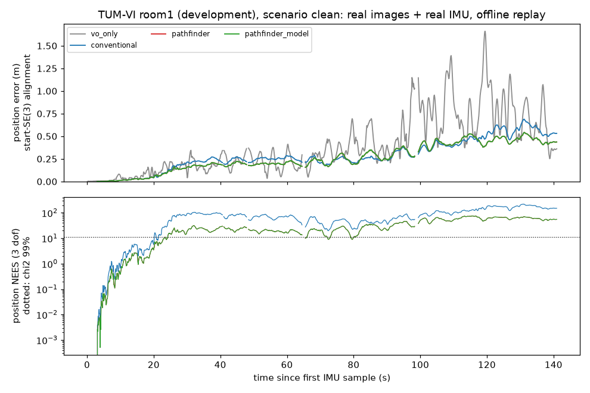
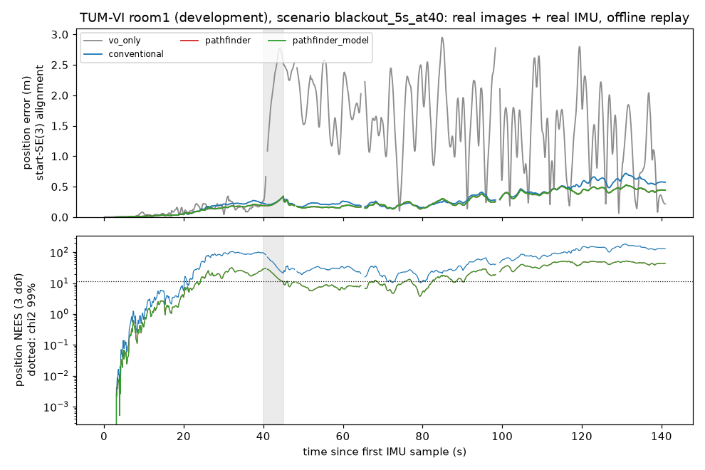
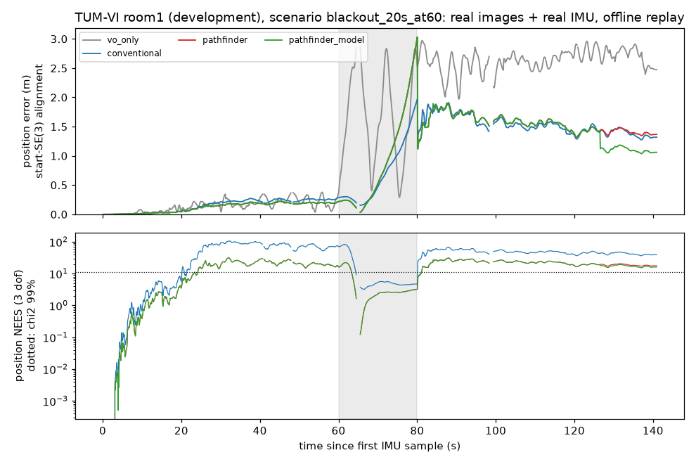
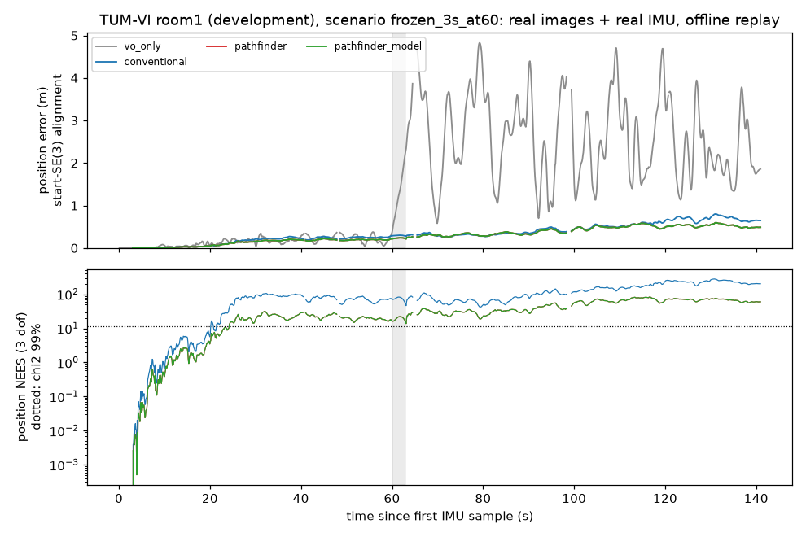
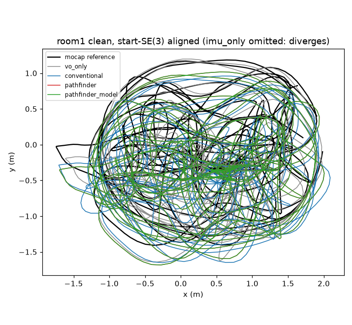
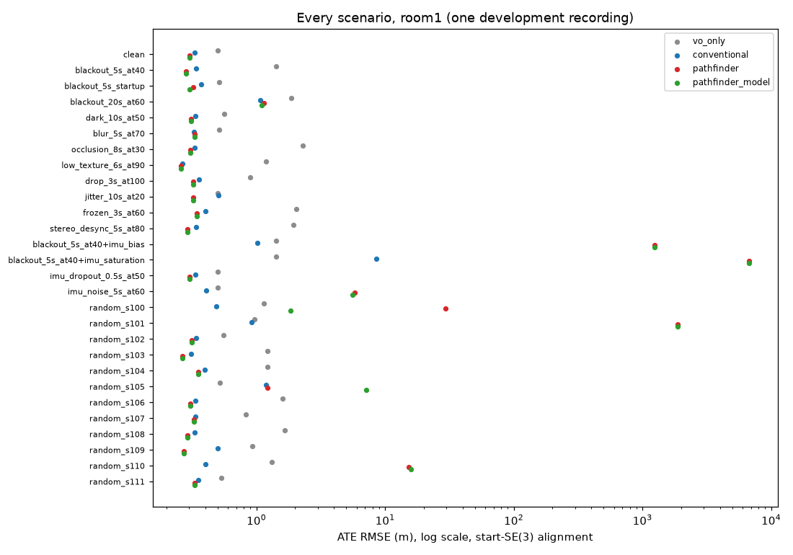

# Real-vision evaluation: room1 (pathfinder.vision-protocol/3)

**Generated by `tools/vision_report.py` from run `20261117T044142Z-vision-room1-c382494-dirty-0f9eb68c5d19` (status: complete).** Real stereo images and the real single IMU of TUM-VI room1, replayed offline; faults are injected into images/IMU *before* the front end/estimator. No system receives the reference; no system is started from it. room1 is a **development** recording (see `data/exposure.json`): these are integration and development results on one exposed recording, not an untouched final test and not evidence of general superiority.

## Frozen configuration

- VO covariance scale 2.0 and keyframe interval 2 (selected on room1 0–60 s, calibration run `20261117T043623Z-calibrate-vo-room1-c382494-dirty-66d484d1fcd1`)
- IMU noise from the dataset's `imu_config.yaml`: {"sigma_g": 0.00016, "sigma_a": 0.0028, "sigma_bg": 2.2e-05, "sigma_ba": 0.00086}
- camera–IMU time offset applied: 0.0 s (measured 0.00017 s; protocol applies it only if > 1 ms)
- front-end source sha256 `a55a14aaf79265ffaef175031d1110597137b32759a13d943115958c891da398`; calibration OpenCV `5.0.0`, runtime OpenCV `5.0.0`
- `vo_covariance_validated` is false. A matching OpenCV version is part of the front-end fingerprint because KLT is not stable across versions.
- learned model: `models/dispnet_faults/best.pt` sha256 `611e97fdad4ac7735a3086179e059edb772f6d93d13a40c3b88b8d4bfec3eba3` (trained on TLIO headset data: cross-device here)
- initialisation: reference-free gravity start for every filter (odometry frame = start pose, velocity unknown)
- scoring: start-SE(3) alignment at the first initialised estimate (primary; drift fully visible), 4-DoF full-trajectory fit (secondary); never re-aligned per outage; mocap gaps > 50 ms excluded
- validity: VO covariance is not validated on held-out data, so every relative-mode output is `COVARIANCE_UNRELIABLE` and `valid=False` by contract; errors below are over **all estimated** samples

## Main results (ATE RMSE, m; all estimated samples)

| scenario | vo_only | imu_only | conventional | pathfinder | pathfinder_model |
|---|---|---|---|---|---|
| clean | 0.504 | 218.693 | 0.333 | 0.301 | 0.301 |
| blackout_5s_at40 | 1.418 | 218.693 | 0.338 | 0.285 | 0.285 |
| blackout_5s_startup | 0.514 | 218.693 | 0.374 | 0.323 | 0.302 |
| blackout_20s_at60 | 1.867 | 218.693 | 1.078 | 1.136 | 1.100 |
| dark_10s_at50 | 0.562 | 218.693 | 0.335 | 0.310 | 0.310 |
| blur_5s_at70 | 0.513 | 218.693 | 0.328 | 0.330 | 0.330 |
| occlusion_8s_at30 | 2.297 | 218.693 | 0.330 | 0.308 | 0.308 |
| low_texture_6s_at90 | 1.182 | 218.693 | 0.268 | 0.259 | 0.259 |
| drop_3s_at100 | 0.892 | 218.693 | 0.360 | 0.322 | 0.322 |
| jitter_10s_at20 | 0.504 | 218.693 | 0.509 | 0.324 | 0.324 |
| frozen_3s_at60 | 2.050 | 218.693 | 0.403 | 0.345 | 0.345 |
| stereo_desync_5s_at80 | 1.938 | 218.693 | 0.340 | 0.293 | 0.293 |
| blackout_5s_at40+imu_bias | 1.418 | 1209.522 | 1.012 | 1247.183 | 1247.183 |
| blackout_5s_at40+imu_saturation | 1.418 | 6701.866 | 8.570 | 6776.868 | 6776.868 |
| imu_dropout_0.5s_at50 | 0.504 | 1415.253 | 0.335 | 0.304 | 0.304 |
| imu_noise_5s_at60 | 0.504 | 194.691 | 0.406 | 5.839 | 5.601 |
| random_s100 | 1.148 | 1207.081 | 0.485 | 29.390 | 1.836 |
| random_s101 | 0.969 | 2889.988 | 0.913 | 1887.210 | 1887.210 |
| random_s102 | 0.555 | 218.693 | 0.342 | 0.314 | 0.314 |
| random_s103 | 1.212 | 218.693 | 0.312 | 0.267 | 0.267 |
| random_s104 | 1.214 | 218.693 | 0.395 | 0.351 | 0.351 |
| random_s105 | 0.522 | 5757.266 | 1.192 | 1.215 | 7.184 |
| random_s106 | 1.599 | 218.693 | 0.337 | 0.307 | 0.307 |
| random_s107 | 0.825 | 218.693 | 0.334 | 0.326 | 0.326 |
| random_s108 | 1.656 | 218.693 | 0.332 | 0.290 | 0.290 |
| random_s109 | 0.931 | 218.693 | 0.501 | 0.272 | 0.272 |
| random_s110 | 1.314 | 1801.912 | 0.402 | 15.189 | 15.840 |
| random_s111 | 0.534 | 218.693 | 0.355 | 0.331 | 0.331 |

## Paired scenario-level deltas (negative = first system better)

| a vs b | n | median Δ m | mean Δ m | a better | b better | bootstrap 95% of median | worst case for a |
|---|---|---|---|---|---|---|---|
| pathfinder vs conventional | 28 | -0.026 | 355.321 | 19 | 9 | [-0.040, -0.003] | blackout_5s_at40+imu_saturation (6768.298) |
| pathfinder vs vo_only | 28 | -0.246 | 354.987 | 21 | 7 | [-0.797, -0.190] | blackout_5s_at40+imu_saturation (6775.451) |
| pathfinder_model vs pathfinder | 28 | 0.000 | -0.758 | 4 | 2 | [0.000, 0.000] | random_s105 (5.970) |
| pathfinder_no_gate vs pathfinder | 28 | 0.039 | -355.348 | 7 | 21 | [0.013, 0.048] | random_s109 (0.255) |
| pathfinder_uncal_cov vs pathfinder | 28 | 0.104 | 101.225 | 1 | 27 | [0.083, 0.130] | random_s110 (1581.323) |
| pathfinder_no_adaptive_q vs pathfinder | 28 | 0.000 | 0.000 | 0 | 0 | [0.000, 0.000] | clean (0.000) |
| pathfinder_no_health vs pathfinder | 28 | 0.000 | 0.000 | 0 | 0 | [0.000, 0.000] | clean (0.000) |
| pathfinder_model_no_selfcheck vs pathfinder_model | 28 | 0.037 | -271.041 | 8 | 20 | [0.017, 0.048] | jitter_10s_at20 (0.348) |
| pathfinder_model_biascorr vs pathfinder_model | 28 | 0.000 | -0.018 | 4 | 2 | [0.000, 0.000] | random_s110 (0.001) |
| pathfinder vs conventional_gated | 28 | -0.072 | -137.355 | 25 | 3 | [-0.085, -0.056] | blackout_5s_at40+imu_bias (111.156) |
| pathfinder_no_reanchor vs pathfinder | 28 | 0.000 | 124.863 | 1 | 5 | [0.000, 0.000] | random_s110 (1747.508) |

These are descriptive resampling intervals over this fixed list of development scenarios, not population confidence intervals.

- pathfinder vs conventional: excluded 0 unavailable/non-finite pairs: none
  fixed: n=16, mean delta=501.213 m, median delta=-0.028 m.
  random: n=12, mean delta=160.797 m, median delta=-0.026 m.
- pathfinder vs vo_only: excluded 0 unavailable/non-finite pairs: none
  fixed: n=16, mean delta=501.040 m, median delta=-0.227 m.
  random: n=12, mean delta=160.249 m, median delta=-0.370 m.
- pathfinder_model vs pathfinder: excluded 0 unavailable/non-finite pairs: none
  fixed: n=16, mean delta=-0.018 m, median delta=0.000 m.
  random: n=12, mean delta=-1.744 m, median delta=0.000 m.
- pathfinder_no_gate vs pathfinder: excluded 0 unavailable/non-finite pairs: none
  fixed: n=16, mean delta=-501.258 m, median delta=0.037 m.
  random: n=12, mean delta=-160.802 m, median delta=0.041 m.
- pathfinder_uncal_cov vs pathfinder: excluded 0 unavailable/non-finite pairs: none
  fixed: n=16, mean delta=4.788 m, median delta=0.104 m.
  random: n=12, mean delta=229.808 m, median delta=0.104 m.
- pathfinder_no_adaptive_q vs pathfinder: excluded 0 unavailable/non-finite pairs: none
  fixed: n=16, mean delta=0.000 m, median delta=0.000 m.
  random: n=12, mean delta=0.000 m, median delta=0.000 m.
- pathfinder_no_health vs pathfinder: excluded 0 unavailable/non-finite pairs: none
  fixed: n=16, mean delta=0.000 m, median delta=0.000 m.
  random: n=12, mean delta=0.000 m, median delta=0.000 m.
- pathfinder_model_no_selfcheck vs pathfinder_model: excluded 0 unavailable/non-finite pairs: none
  fixed: n=16, mean delta=-357.665 m, median delta=0.040 m.
  random: n=12, mean delta=-155.541 m, median delta=0.035 m.
- pathfinder_model_biascorr vs pathfinder_model: excluded 0 unavailable/non-finite pairs: none
  fixed: n=16, mean delta=-0.000 m, median delta=0.000 m.
  random: n=12, mean delta=-0.041 m, median delta=0.000 m.
- pathfinder vs conventional_gated: excluded 0 unavailable/non-finite pairs: none
  fixed: n=16, mean delta=-11.483 m, median delta=-0.063 m.
  random: n=12, mean delta=-305.185 m, median delta=-0.083 m.
- pathfinder_no_reanchor vs pathfinder: excluded 0 unavailable/non-finite pairs: none
  fixed: n=16, mean delta=15.796 m, median delta=0.000 m.
  random: n=12, mean delta=270.286 m, median delta=0.000 m.

NEES uses aligned errors with marginal position covariance, without anchor cross-covariance correction. It is a gauge-unadjusted diagnostic, not a calibration certificate.

## Clean run detail

| system | ATE | max err | 4-DoF ATE | rot RMSE deg | RPE 1 s m | RPE 1 s deg | final drift % path | ATE after 60 s | NEES≤χ²99% (all) | VO used/rejected |
|---|---|---|---|---|---|---|---|---|---|---|
| vo_only | 0.504 | 1.666 | 0.463 | 31.11 | 0.120 | 8.09 | 0.25 | 0.649 | – | –/– |
| imu_only | 218.693 | 498.057 | 147.877 | 1.48 | 4.275 | 0.54 | 346.20 | 284.541 | 1.00 | 0/0 |
| conventional | 0.333 | 0.689 | 0.197 | 2.10 | 0.025 | 0.63 | 0.37 | 0.407 | 0.13 | 1398/0 |
| pathfinder | 0.301 | 0.543 | 0.173 | 2.29 | 0.023 | 0.60 | 0.30 | 0.374 | 0.18 | 1269/129 |
| pathfinder_no_gate | 0.341 | 0.721 | 0.204 | 2.35 | 0.025 | 0.64 | 0.39 | 0.418 | 0.17 | 1398/0 |
| pathfinder_uncal_cov | 0.385 | 0.677 | 0.197 | 3.20 | 0.025 | 0.58 | 0.31 | 0.476 | 0.15 | 1037/361 |
| pathfinder_no_adaptive_q | 0.301 | 0.543 | 0.173 | 2.29 | 0.023 | 0.60 | 0.30 | 0.374 | 0.18 | 1269/129 |
| pathfinder_no_health | 0.301 | 0.543 | 0.173 | 2.29 | 0.023 | 0.60 | 0.30 | 0.374 | 0.18 | 1269/129 |
| pathfinder_model | 0.301 | 0.543 | 0.173 | 2.29 | 0.023 | 0.60 | 0.30 | 0.374 | 0.18 | 1269/129 |
| pathfinder_model_no_selfcheck | 0.338 | 0.598 | 0.190 | 2.43 | 0.024 | 0.60 | 0.32 | 0.425 | 0.16 | 1269/129 |
| pathfinder_model_biascorr | 0.301 | 0.543 | 0.173 | 2.29 | 0.023 | 0.60 | 0.30 | 0.374 | 0.18 | 1269/129 |
| conventional_gated | 0.362 | 0.694 | 0.195 | 3.72 | 0.023 | 0.59 | 0.35 | 0.449 | 0.18 | 1010/388 |
| pathfinder_no_reanchor | 0.301 | 0.543 | 0.173 | 2.29 | 0.023 | 0.60 | 0.30 | 0.374 | 0.18 | 1269/129 |

The 0–60 s window is the room1 selection segment. ATE after 60 s is the remainder of this same recording under the same start-SE(3) alignment. It is not a separate held-out recording. On room2 the scale and keyframe interval were not re-selected.

## Outage / fault behaviour (Path Finder, conventional, VO only)

Recovery: first time after the fault ends from which the error stays ≤ (error at fault start + 0.10 m) for 2 s; '–' = never within the recording. Step deviation: largest per-sample position step beyond the reference's own step within 2 s after the fault (re-anchoring discontinuity).

| scenario | fault | system | error growth m | error at end m | recovery s | step dev m | NEES≤χ²99% inside |
|---|---|---|---|---|---|---|---|
| blackout_20s_at60 | image:blackout 60.0–80.0 s | vo_only | 2.196 | 2.561 | – | 0.1682 | – |
| blackout_20s_at60 | image:blackout 60.0–80.0 s | conventional | 1.671 | 1.956 | – | 2.1830 | 0.77 |
| blackout_20s_at60 | image:blackout 60.0–80.0 s | pathfinder | 2.796 | 3.011 | – | 3.6152 | 0.83 |
| blackout_20s_at60 | image:blackout 60.0–80.0 s | pathfinder_model | 2.796 | 3.011 | – | 3.6152 | 0.83 |
| blackout_5s_startup | image:blackout 0.0–5.0 s | vo_only | – | 0.000 | – | 0.0672 | – |
| blackout_5s_startup | image:blackout 0.0–5.0 s | conventional | – | 0.269 | – | 0.9322 | 1.00 |
| blackout_5s_startup | image:blackout 0.0–5.0 s | pathfinder | – | 0.269 | – | 0.8056 | 1.00 |
| blackout_5s_startup | image:blackout 0.0–5.0 s | pathfinder_model | – | 0.013 | – | 0.0078 | 1.00 |
| blackout_5s_at40 | image:blackout 40.0–45.0 s | vo_only | 2.238 | 2.539 | 93.7 | 0.1248 | – |
| blackout_5s_at40 | image:blackout 40.0–45.0 s | conventional | 0.111 | 0.337 | 0.1 | 0.0954 | 0.00 |
| blackout_5s_at40 | image:blackout 40.0–45.0 s | pathfinder | 0.151 | 0.340 | 0.1 | 0.1063 | 0.02 |
| blackout_5s_at40 | image:blackout 40.0–45.0 s | pathfinder_model | 0.151 | 0.340 | 0.1 | 0.1063 | 0.02 |
| dark_10s_at50 | image:dark 50.0–60.0 s | vo_only | 0.034 | 0.184 | 6.5 | 0.1173 | – |
| dark_10s_at50 | image:dark 50.0–60.0 s | conventional | 0.094 | 0.321 | 0.0 | 0.0125 | 0.00 |
| dark_10s_at50 | image:dark 50.0–60.0 s | pathfinder | 0.069 | 0.248 | 0.0 | 0.0203 | 0.00 |
| dark_10s_at50 | image:dark 50.0–60.0 s | pathfinder_model | 0.069 | 0.248 | 0.0 | 0.0203 | 0.00 |
| blur_5s_at70 | image:blur 70.0–75.0 s | vo_only | 0.180 | 0.457 | 63.7 | 0.1098 | – |
| blur_5s_at70 | image:blur 70.0–75.0 s | conventional | 0.099 | 0.304 | 4.1 | 0.0076 | 0.00 |
| blur_5s_at70 | image:blur 70.0–75.0 s | pathfinder | 0.079 | 0.312 | 2.2 | 0.0099 | 0.00 |
| blur_5s_at70 | image:blur 70.0–75.0 s | pathfinder_model | 0.079 | 0.312 | 2.2 | 0.0099 | 0.00 |
| occlusion_8s_at30 | image:occlusion 30.0–38.0 s | vo_only | 1.098 | 1.171 | – | 0.1390 | – |
| occlusion_8s_at30 | image:occlusion 30.0–38.0 s | conventional | 0.079 | 0.294 | 0.0 | 0.1261 | 0.00 |
| occlusion_8s_at30 | image:occlusion 30.0–38.0 s | pathfinder | 0.072 | 0.232 | 0.0 | 0.0707 | 0.19 |
| occlusion_8s_at30 | image:occlusion 30.0–38.0 s | pathfinder_model | 0.072 | 0.232 | 0.0 | 0.0707 | 0.19 |
| drop_3s_at100 | image:drop 100.0–103.0 s | vo_only | 0.561 | 1.291 | – | 0.2101 | – |
| drop_3s_at100 | image:drop 100.0–103.0 s | conventional | -0.029 | 0.320 | 4.3 | 0.0470 | 0.00 |
| drop_3s_at100 | image:drop 100.0–103.0 s | pathfinder | -0.028 | 0.357 | 2.6 | 0.0533 | 0.00 |
| drop_3s_at100 | image:drop 100.0–103.0 s | pathfinder_model | -0.028 | 0.357 | 2.6 | 0.0533 | 0.00 |
| stereo_desync_5s_at80 | image:stereo_desync 80.0–85.0 s | vo_only | 2.703 | 3.214 | – | 0.1390 | – |
| stereo_desync_5s_at80 | image:stereo_desync 80.0–85.0 s | conventional | 0.018 | 0.226 | 0.0 | 0.1291 | 0.19 |
| stereo_desync_5s_at80 | image:stereo_desync 80.0–85.0 s | pathfinder | 0.088 | 0.281 | – | 0.0842 | 0.61 |
| stereo_desync_5s_at80 | image:stereo_desync 80.0–85.0 s | pathfinder_model | 0.088 | 0.281 | – | 0.0842 | 0.61 |
| jitter_10s_at20 | image:jitter 20.0–30.0 s | vo_only | -0.011 | 0.076 | 2.8 | 0.1515 | – |
| jitter_10s_at20 | image:jitter 20.0–30.0 s | conventional | 0.600 | 0.646 | – | 0.0354 | 0.01 |
| jitter_10s_at20 | image:jitter 20.0–30.0 s | pathfinder | 0.276 | 0.325 | – | 0.0984 | 0.86 |
| jitter_10s_at20 | image:jitter 20.0–30.0 s | pathfinder_model | 0.276 | 0.325 | – | 0.0984 | 0.86 |
| frozen_3s_at60 | image:frozen 60.0–63.0 s | vo_only | 1.920 | 2.285 | – | 0.1373 | – |
| frozen_3s_at60 | image:frozen 60.0–63.0 s | conventional | -0.006 | 0.278 | 2.4 | 0.0326 | 0.00 |
| frozen_3s_at60 | image:frozen 60.0–63.0 s | pathfinder | 0.004 | 0.219 | 2.4 | 0.0375 | 0.00 |
| frozen_3s_at60 | image:frozen 60.0–63.0 s | pathfinder_model | 0.004 | 0.219 | 2.4 | 0.0375 | 0.00 |
| low_texture_6s_at90 | image:low_texture 90.0–96.0 s | vo_only | 0.905 | 1.298 | – | 0.1822 | – |
| low_texture_6s_at90 | image:low_texture 90.0–96.0 s | conventional | 0.277 | 0.520 | 0.1 | 0.2808 | 0.00 |
| low_texture_6s_at90 | image:low_texture 90.0–96.0 s | pathfinder | 0.382 | 0.623 | 6.1 | 0.3400 | 0.08 |
| low_texture_6s_at90 | image:low_texture 90.0–96.0 s | pathfinder_model | 0.382 | 0.623 | 6.1 | 0.3400 | 0.08 |
| blackout_5s_at40+imu_bias | image:blackout 40.0–45.0 s | vo_only | 2.238 | 2.539 | 93.7 | 0.1248 | – |
| blackout_5s_at40+imu_bias | imu:bias 35.0–142.1 s | vo_only | – | – | – | – | – |
| blackout_5s_at40+imu_bias | image:blackout 40.0–45.0 s | conventional | 5.475 | 5.579 | – | 3.4141 | 0.03 |
| blackout_5s_at40+imu_bias | imu:bias 35.0–142.1 s | conventional | – | – | – | – | 0.00 |
| blackout_5s_at40+imu_bias | image:blackout 40.0–45.0 s | pathfinder | 9.026 | 13.566 | – | 0.0208 | 0.00 |
| blackout_5s_at40+imu_bias | imu:bias 35.0–142.1 s | pathfinder | – | – | – | – | 0.00 |
| blackout_5s_at40+imu_bias | image:blackout 40.0–45.0 s | pathfinder_model | 9.026 | 13.566 | – | 0.0208 | 0.00 |
| blackout_5s_at40+imu_bias | imu:bias 35.0–142.1 s | pathfinder_model | – | – | – | – | 0.00 |
| blackout_5s_at40+imu_saturation | image:blackout 40.0–45.0 s | vo_only | 2.238 | 2.539 | 93.7 | 0.1248 | – |
| blackout_5s_at40+imu_saturation | imu:saturation 40.0–45.0 s | vo_only | 2.238 | 2.539 | 93.7 | 0.1248 | – |
| blackout_5s_at40+imu_saturation | image:blackout 40.0–45.0 s | conventional | 20.754 | 20.979 | – | 25.1240 | 0.00 |
| blackout_5s_at40+imu_saturation | imu:saturation 40.0–45.0 s | conventional | 20.754 | 20.979 | – | 25.1240 | 0.00 |
| blackout_5s_at40+imu_saturation | image:blackout 40.0–45.0 s | pathfinder | 20.859 | 21.048 | – | 1.7282 | 0.00 |
| blackout_5s_at40+imu_saturation | imu:saturation 40.0–45.0 s | pathfinder | 20.859 | 21.048 | – | 1.7282 | 0.00 |
| blackout_5s_at40+imu_saturation | image:blackout 40.0–45.0 s | pathfinder_model | 20.859 | 21.048 | – | 1.7282 | 0.00 |
| blackout_5s_at40+imu_saturation | imu:saturation 40.0–45.0 s | pathfinder_model | 20.859 | 21.048 | – | 1.7282 | 0.00 |
| imu_dropout_0.5s_at50 | imu:dropout 50.0–50.5 s | vo_only | -0.011 | 0.139 | 2.2 | 0.1317 | – |
| imu_dropout_0.5s_at50 | imu:dropout 50.0–50.5 s | conventional | 0.018 | 0.245 | 0.0 | 0.0151 | 0.00 |
| imu_dropout_0.5s_at50 | imu:dropout 50.0–50.5 s | pathfinder | 0.011 | 0.190 | 0.0 | 0.0151 | 0.09 |
| imu_dropout_0.5s_at50 | imu:dropout 50.0–50.5 s | pathfinder_model | 0.011 | 0.190 | 0.0 | 0.0151 | 0.09 |
| imu_noise_5s_at60 | imu:noise 60.0–65.0 s | vo_only | – | – | 0.4 | 0.1312 | – |
| imu_noise_5s_at60 | imu:noise 60.0–65.0 s | conventional | – | – | 0.4 | 0.0150 | 0.00 |
| imu_noise_5s_at60 | imu:noise 60.0–65.0 s | pathfinder | – | – | – | 0.0047 | 0.32 |
| imu_noise_5s_at60 | imu:noise 60.0–65.0 s | pathfinder_model | – | – | – | 0.0047 | 0.32 |
| random_s100 | image:frozen 5.9–8.9 s | vo_only | 0.829 | 0.832 | – | 0.0950 | – |
| random_s100 | image:drop 82.8–92.3 s | vo_only | 0.442 | 1.381 | – | 0.1653 | – |
| random_s100 | image:stereo_desync 93.4–98.7 s | vo_only | – | – | 0.7 | 0.2419 | – |
| random_s100 | imu:spikes 10.9–14.0 s | vo_only | 0.049 | 0.808 | 3.7 | 0.1200 | – |
| random_s100 | image:frozen 5.9–8.9 s | conventional | 0.032 | 0.034 | 0.0 | 0.0314 | 1.00 |
| random_s100 | image:drop 82.8–92.3 s | conventional | 0.500 | 0.868 | – | 0.6370 | 0.00 |
| random_s100 | image:stereo_desync 93.4–98.7 s | conventional | – | – | – | 0.0280 | 0.00 |
| random_s100 | imu:spikes 10.9–14.0 s | conventional | 0.275 | 0.296 | – | 0.0196 | 0.08 |
| random_s100 | image:frozen 5.9–8.9 s | pathfinder | 0.035 | 0.037 | 0.0 | 0.0353 | 1.00 |
| random_s100 | image:drop 82.8–92.3 s | pathfinder | 0.676 | 31.955 | 0.1 | 0.6832 | 0.00 |
| random_s100 | image:stereo_desync 93.4–98.7 s | pathfinder | – | – | – | 0.0254 | 0.00 |
| random_s100 | imu:spikes 10.9–14.0 s | pathfinder | 1.599 | 1.622 | – | 0.0067 | 0.13 |
| random_s100 | image:frozen 5.9–8.9 s | pathfinder_model | 0.453 | 0.455 | – | 0.0325 | 0.80 |
| random_s100 | image:drop 82.8–92.3 s | pathfinder_model | -0.085 | 1.854 | 3.4 | 0.6481 | 0.00 |
| random_s100 | image:stereo_desync 93.4–98.7 s | pathfinder_model | – | – | 6.3 | 0.0264 | 0.00 |
| random_s100 | imu:spikes 10.9–14.0 s | pathfinder_model | -0.131 | 1.114 | – | 0.0910 | 0.00 |
| random_s101 | image:stereo_desync 82.5–84.0 s | vo_only | 1.095 | 1.429 | – | 0.1264 | – |
| random_s101 | imu:saturation 28.5–30.8 s | vo_only | 0.080 | 0.281 | 0.8 | 0.1476 | – |
| random_s101 | image:stereo_desync 82.5–84.0 s | conventional | -0.081 | 0.991 | 0.0 | 0.0474 | 0.00 |
| random_s101 | imu:saturation 28.5–30.8 s | conventional | 0.644 | 0.831 | – | 0.1272 | 0.00 |
| random_s101 | image:stereo_desync 82.5–84.0 s | pathfinder | 56.626 | 943.089 | – | 0.2084 | 0.00 |
| random_s101 | imu:saturation 28.5–30.8 s | pathfinder | 2.139 | 2.279 | – | 0.0210 | 0.00 |
| random_s101 | image:stereo_desync 82.5–84.0 s | pathfinder_model | 56.626 | 943.089 | – | 0.2084 | 0.00 |
| random_s101 | imu:saturation 28.5–30.8 s | pathfinder_model | 2.139 | 2.279 | – | 0.0210 | 0.00 |
| random_s102 | image:blur 41.1–44.0 s | vo_only | -0.145 | 0.180 | 0.0 | 0.1198 | – |
| random_s102 | image:drop 132.9–140.1 s | vo_only | 0.140 | 0.755 | – | 0.0115 | – |
| random_s102 | image:blur 41.1–44.0 s | conventional | 0.082 | 0.278 | 0.0 | 0.0079 | 0.00 |
| random_s102 | image:drop 132.9–140.1 s | conventional | 0.037 | 0.677 | – | 0.2048 | 0.00 |
| random_s102 | image:blur 41.1–44.0 s | pathfinder | 0.061 | 0.237 | 0.0 | 0.0106 | 0.00 |
| random_s102 | image:drop 132.9–140.1 s | pathfinder | 0.173 | 0.685 | – | 0.3994 | 0.05 |
| random_s102 | image:blur 41.1–44.0 s | pathfinder_model | 0.061 | 0.237 | 0.0 | 0.0106 | 0.00 |
| random_s102 | image:drop 132.9–140.1 s | pathfinder_model | 0.173 | 0.685 | – | 0.3994 | 0.05 |
| random_s103 | image:blackout 98.1–99.3 s | vo_only | – | – | – | 0.2481 | – |
| random_s103 | image:blackout 120.5–121.5 s | vo_only | -0.555 | 0.774 | – | 0.1945 | – |
| random_s103 | image:blackout 98.1–99.3 s | conventional | – | – | 0.1 | 0.0144 | 0.00 |
| random_s103 | image:blackout 120.5–121.5 s | conventional | -0.013 | 0.485 | 0.0 | 0.0183 | 0.00 |
| random_s103 | image:blackout 98.1–99.3 s | pathfinder | – | – | 2.5 | 0.0313 | 0.00 |
| random_s103 | image:blackout 120.5–121.5 s | pathfinder | -0.003 | 0.372 | 0.0 | 0.0172 | 0.00 |
| random_s103 | image:blackout 98.1–99.3 s | pathfinder_model | – | – | 2.5 | 0.0313 | 0.00 |
| random_s103 | image:blackout 120.5–121.5 s | pathfinder_model | -0.003 | 0.372 | 0.0 | 0.0172 | 0.00 |
| random_s105 | image:drop 0.0–9.7 s | vo_only | – | 0.000 | – | 0.1169 | – |
| random_s105 | imu:dropout 72.7–79.0 s | vo_only | 0.073 | 0.521 | 0.9 | 0.1422 | – |
| random_s105 | image:drop 0.0–9.7 s | conventional | – | 1.527 | – | 6.2613 | 1.00 |
| random_s105 | imu:dropout 72.7–79.0 s | conventional | 0.002 | 0.471 | 0.0 | 0.0328 | 1.00 |
| random_s105 | image:drop 0.0–9.7 s | pathfinder | – | 1.527 | – | 4.7517 | 1.00 |
| random_s105 | imu:dropout 72.7–79.0 s | pathfinder | -0.012 | 0.839 | 0.0 | 0.0323 | 1.00 |
| random_s105 | image:drop 0.0–9.7 s | pathfinder_model | – | 0.538 | – | 0.1290 | 0.39 |
| random_s105 | imu:dropout 72.7–79.0 s | pathfinder_model | -0.076 | 5.016 | – | 0.0334 | 0.00 |
| random_s104 | image:frozen 17.2–21.2 s | vo_only | 1.150 | 1.252 | – | 0.0929 | – |
| random_s104 | image:blur 88.1–92.6 s | vo_only | -0.897 | 0.705 | 0.0 | 0.2036 | – |
| random_s104 | image:jitter 106.2–106.8 s | vo_only | -0.244 | 1.090 | 7.2 | 0.2469 | – |
| random_s104 | image:frozen 17.2–21.2 s | conventional | 0.066 | 0.097 | – | 0.2317 | 1.00 |
| random_s104 | image:blur 88.1–92.6 s | conventional | 0.077 | 0.368 | 3.6 | 0.0175 | 0.00 |
| random_s104 | image:jitter 106.2–106.8 s | conventional | -0.043 | 0.428 | 0.0 | 0.0875 | 0.00 |
| random_s104 | image:frozen 17.2–21.2 s | pathfinder | 0.071 | 0.101 | – | 0.2335 | 1.00 |
| random_s104 | image:blur 88.1–92.6 s | pathfinder | 0.136 | 0.411 | – | 0.0175 | 0.00 |
| random_s104 | image:jitter 106.2–106.8 s | pathfinder | -0.001 | 0.440 | 0.0 | 0.0167 | 0.00 |
| random_s104 | image:frozen 17.2–21.2 s | pathfinder_model | 0.071 | 0.101 | – | 0.2335 | 1.00 |
| random_s104 | image:blur 88.1–92.6 s | pathfinder_model | 0.136 | 0.411 | – | 0.0175 | 0.00 |
| random_s104 | image:jitter 106.2–106.8 s | pathfinder_model | -0.001 | 0.440 | 0.0 | 0.0167 | 0.00 |
| random_s106 | image:blackout 44.9–46.3 s | vo_only | 0.991 | 1.270 | – | 0.1223 | – |
| random_s106 | image:stereo_desync 65.2–65.8 s | vo_only | – | 2.671 | – | 0.1408 | – |
| random_s106 | image:blackout 44.9–46.3 s | conventional | -0.002 | 0.270 | 2.1 | 0.0177 | 0.00 |
| random_s106 | image:stereo_desync 65.2–65.8 s | conventional | – | 0.212 | – | 0.0116 | 0.00 |
| random_s106 | image:blackout 44.9–46.3 s | pathfinder | 0.004 | 0.227 | 2.1 | 0.0203 | 0.00 |
| random_s106 | image:stereo_desync 65.2–65.8 s | pathfinder | – | 0.169 | – | 0.0107 | 0.75 |
| random_s106 | image:blackout 44.9–46.3 s | pathfinder_model | 0.004 | 0.227 | 2.1 | 0.0203 | 0.00 |
| random_s106 | image:stereo_desync 65.2–65.8 s | pathfinder_model | – | 0.169 | – | 0.0107 | 0.75 |
| random_s107 | image:drop 102.1–104.2 s | vo_only | 0.957 | 1.707 | 2.0 | 0.2004 | – |
| random_s107 | image:drop 102.1–104.2 s | conventional | 0.003 | 0.355 | 1.5 | 0.1020 | 0.00 |
| random_s107 | image:drop 102.1–104.2 s | pathfinder | 0.029 | 0.409 | 2.9 | 0.0857 | 0.00 |
| random_s107 | image:drop 102.1–104.2 s | pathfinder_model | 0.029 | 0.409 | 2.9 | 0.0857 | 0.00 |
| random_s108 | image:frozen 48.3–51.6 s | vo_only | 2.627 | 2.977 | – | 0.1419 | – |
| random_s108 | image:frozen 48.3–51.6 s | conventional | -0.011 | 0.201 | 0.0 | 0.0259 | 0.00 |
| random_s108 | image:frozen 48.3–51.6 s | pathfinder | -0.022 | 0.161 | 0.0 | 0.0152 | 0.36 |
| random_s108 | image:frozen 48.3–51.6 s | pathfinder_model | -0.022 | 0.161 | 0.0 | 0.0152 | 0.36 |
| random_s109 | image:low_texture 44.7–50.9 s | vo_only | 0.245 | 0.504 | – | 0.1346 | – |
| random_s109 | image:dark 76.1–76.9 s | vo_only | -0.703 | 0.347 | 5.6 | 0.1304 | – |
| random_s109 | image:low_texture 44.7–50.9 s | conventional | -0.013 | 0.255 | 0.0 | 0.0172 | 0.00 |
| random_s109 | image:dark 76.1–76.9 s | conventional | 0.136 | 0.395 | 0.1 | 0.1808 | 0.00 |
| random_s109 | image:low_texture 44.7–50.9 s | pathfinder | -0.050 | 0.168 | 0.0 | 0.0176 | 0.11 |
| random_s109 | image:dark 76.1–76.9 s | pathfinder | -0.006 | 0.281 | 0.0 | 0.0191 | 0.00 |
| random_s109 | image:low_texture 44.7–50.9 s | pathfinder_model | -0.050 | 0.168 | 0.0 | 0.0176 | 0.11 |
| random_s109 | image:dark 76.1–76.9 s | pathfinder_model | -0.006 | 0.281 | 0.0 | 0.0191 | 0.00 |
| random_s110 | image:blackout 13.7–14.4 s | vo_only | 0.323 | 0.346 | – | 0.1202 | – |
| random_s110 | image:stereo_desync 69.7–72.0 s | vo_only | 1.121 | 1.836 | – | 0.1253 | – |
| random_s110 | imu:bias 26.7–29.6 s | vo_only | 0.053 | 0.579 | 0.2 | 0.1516 | – |
| random_s110 | image:blackout 13.7–14.4 s | conventional | 0.000 | 0.029 | 0.0 | 0.0091 | 1.00 |
| random_s110 | image:stereo_desync 69.7–72.0 s | conventional | -0.153 | 0.189 | 0.0 | 0.0190 | 0.00 |
| random_s110 | imu:bias 26.7–29.6 s | conventional | 0.223 | 0.378 | 26.3 | 0.0802 | 0.00 |
| random_s110 | image:blackout 13.7–14.4 s | pathfinder | 0.001 | 0.027 | 0.0 | 0.0096 | 1.00 |
| random_s110 | image:stereo_desync 69.7–72.0 s | pathfinder | -0.180 | 17.571 | 0.0 | 0.0878 | 0.00 |
| random_s110 | imu:bias 26.7–29.6 s | pathfinder | 1.675 | 1.806 | – | 0.2201 | 0.00 |
| random_s110 | image:blackout 13.7–14.4 s | pathfinder_model | 0.001 | 0.027 | 0.0 | 0.0096 | 1.00 |
| random_s110 | image:stereo_desync 69.7–72.0 s | pathfinder_model | 0.287 | 18.714 | – | 0.0346 | 0.00 |
| random_s110 | imu:bias 26.7–29.6 s | pathfinder_model | 1.675 | 1.806 | – | 0.2201 | 0.00 |
| random_s111 | image:jitter 33.5–38.9 s | vo_only | 0.001 | 0.152 | 13.8 | 0.1253 | – |
| random_s111 | image:blur 92.3–93.1 s | vo_only | 0.097 | 0.476 | 45.2 | 0.2010 | – |
| random_s111 | image:jitter 33.5–38.9 s | conventional | 0.064 | 0.290 | 2.0 | 0.0090 | 0.00 |
| random_s111 | image:blur 92.3–93.1 s | conventional | 0.022 | 0.394 | 0.0 | 0.0135 | 0.00 |
| random_s111 | image:jitter 33.5–38.9 s | pathfinder | 0.090 | 0.268 | 2.0 | 0.0089 | 0.00 |
| random_s111 | image:blur 92.3–93.1 s | pathfinder | 0.034 | 0.422 | 0.0 | 0.0197 | 0.00 |
| random_s111 | image:jitter 33.5–38.9 s | pathfinder_model | 0.090 | 0.268 | 2.0 | 0.0089 | 0.00 |
| random_s111 | image:blur 92.3–93.1 s | pathfinder_model | 0.034 | 0.422 | 0.0 | 0.0197 | 0.00 |

## Failures and harness errors

- none: every scenario × system produced scored output

## Runtime

- front end (decode + corrupt + VO), batch evaluation, clean room1: p50 59.2 ms, p95 122.2 ms, p99 172.4 ms per frame
- estimator `vo_only`: 58 µs per IMU sample (mean, offline replay incl. Python overhead)
- estimator `imu_only`: 1550 µs per IMU sample (mean, offline replay incl. Python overhead)
- estimator `conventional`: 1839 µs per IMU sample (mean, offline replay incl. Python overhead)
- estimator `pathfinder`: 2223 µs per IMU sample (mean, offline replay incl. Python overhead)
- estimator `pathfinder_no_gate`: 2092 µs per IMU sample (mean, offline replay incl. Python overhead)
- estimator `pathfinder_uncal_cov`: 1661 µs per IMU sample (mean, offline replay incl. Python overhead)
- estimator `pathfinder_no_adaptive_q`: 1791 µs per IMU sample (mean, offline replay incl. Python overhead)
- estimator `pathfinder_no_health`: 1593 µs per IMU sample (mean, offline replay incl. Python overhead)
- estimator `pathfinder_model`: 2467 µs per IMU sample (mean, offline replay incl. Python overhead)
- estimator `pathfinder_model_no_selfcheck`: 1967 µs per IMU sample (mean, offline replay incl. Python overhead)
- estimator `pathfinder_model_biascorr`: 2226 µs per IMU sample (mean, offline replay incl. Python overhead)
- estimator `conventional_gated`: 1591 µs per IMU sample (mean, offline replay incl. Python overhead)
- estimator `pathfinder_no_reanchor`: 1635 µs per IMU sample (mean, offline replay incl. Python overhead)
- causal single-thread profile on **11th Gen Intel(R) Core(TM) i7-11800H @ 2.30GHz** (Windows-11-10.0.26300-SP0, Python 3.13.5, single thread (BLAS/OMP/torch = 1)): frame total p50/p95/p99 24.9/78.8/94.0 ms (276 of 1200 frames over 50 ms); IMU step p50/p99 0.52/5.89 ms; real-time factor 0.86; peak RSS 277 MB. laptop CPU replay from disk; not headset/NPU evidence.

## Learned model

Diagnostic source run: `20261115T171018Z-model-shift-797eb67`. offline analysis; reference orientation used to rotate TUM-VI IMU (diagnostic only)
These windows overlap and are development/validation diagnostics, not independent held-out trajectory evidence.

| Domain | RMSE (m) | Mean NEES | Integrated autocorrelation time |
|---|---:|---:|---:|
| tlio_val_in_domain | 0.138 | 3.055 | 11.240 |
| tumvi_room1_cross_device | 0.807 | 45.577 | 14.732 |
Cross-device/in-domain displacement RMSE ratio: 5.85.

## Figures

## What this does not show

- Comparison systems in this file are the in-repo VO-only chain and a conventional loosely coupled filter. An established external VIO is a separate baseline and is not fed back into these filters, because that would count the IMU twice.
- One development recording: no recording-level statistics, no cross-device result, no untouched final test.
- VO covariance validity is not established; the learned model is evaluated cross-device without calibration.
- `cv2.IMREAD_GRAYSCALE` keeps the top 8 bits of the 16-bit TUM-VI PNGs. That conversion is a recorded limit of this front end.
- A previous protocol report on the same recording used a different front-end hash. It is not a single-change ablation of this run.
- Runtime is a laptop replay; no headset, NPU, thermal or multi-threaded scheduler measurement.
