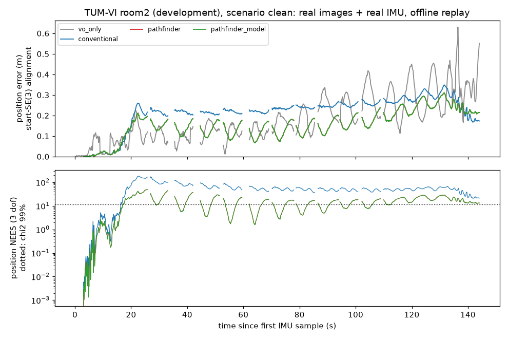
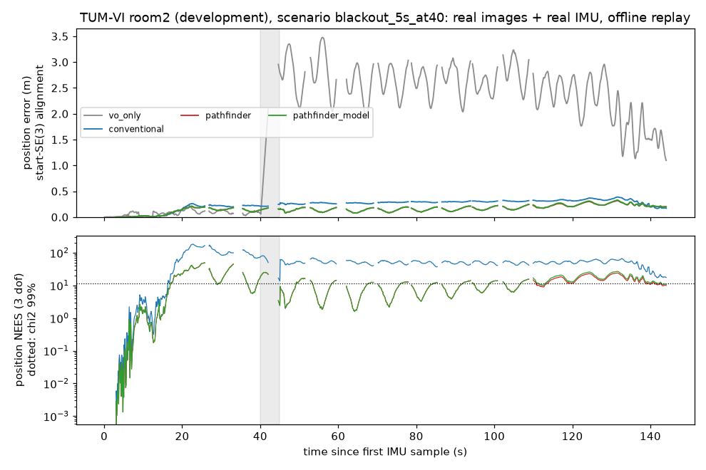
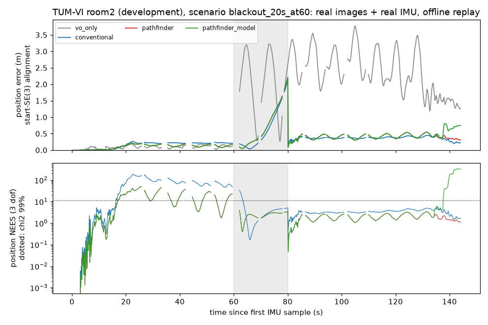
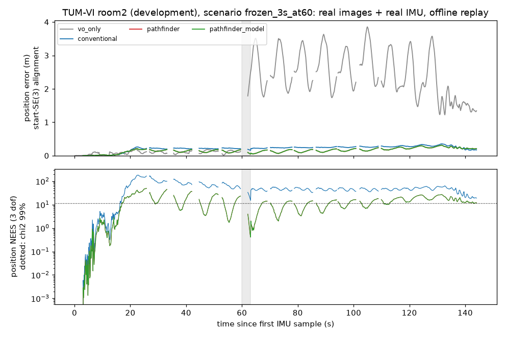
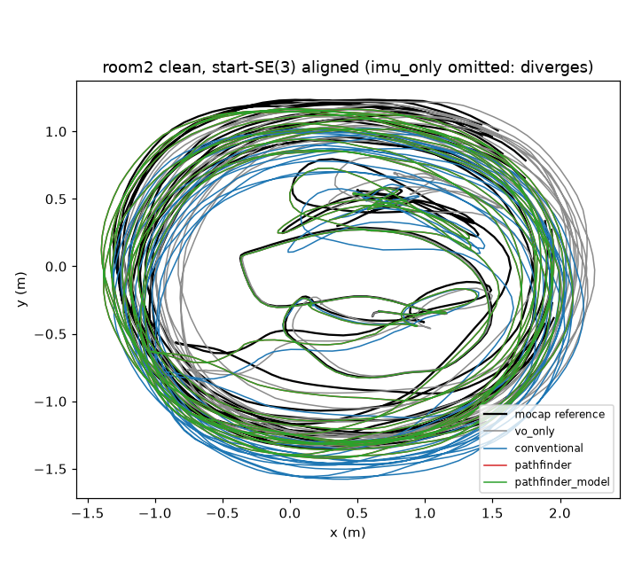
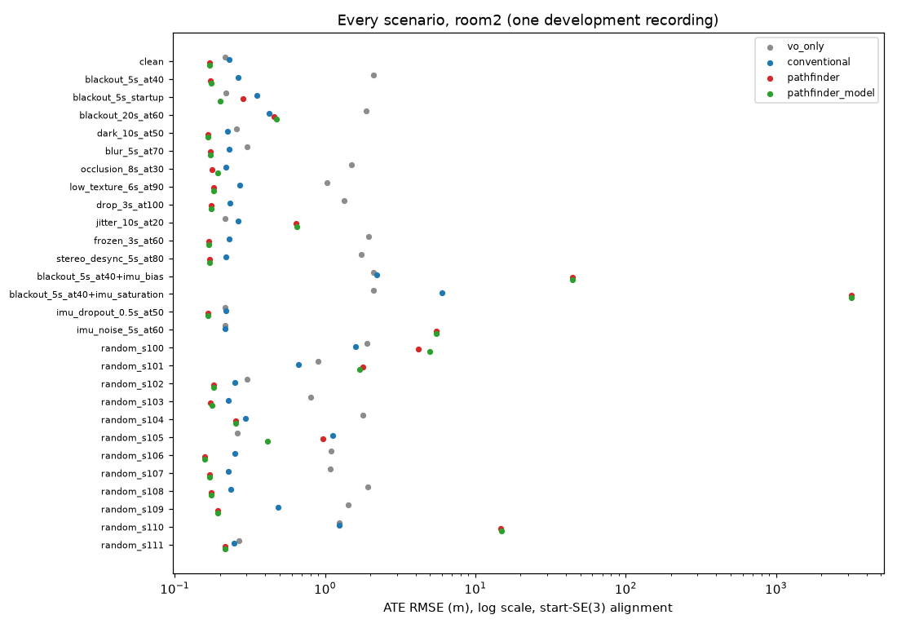

# Real-vision evaluation: room2 (pathfinder.vision-protocol/3)

**Generated by `tools/vision_report.py` from run `20261117T074116Z-vision-room2-c382494-dirty-aecb758396b1` (status: complete).** Real stereo images and the real single IMU of TUM-VI room2, replayed offline; faults are injected into images/IMU *before* the front end/estimator. No system receives the reference; no system is started from it. room2 is a **development** recording (see `data/exposure.json`): these are integration and development results on one exposed recording, not an untouched final test and not evidence of general superiority.

## Frozen configuration

- VO covariance scale 2.0 and keyframe interval 2 (selected on room1 0–60 s, calibration run `20261117T043623Z-calibrate-vo-room1-c382494-dirty-66d484d1fcd1`)
- IMU noise from the dataset's `imu_config.yaml`: {"sigma_g": 0.00016, "sigma_a": 0.0028, "sigma_bg": 2.2e-05, "sigma_ba": 0.00086}
- camera–IMU time offset applied: 0.0 s (measured – s; protocol applies it only if > 1 ms)
- front-end source sha256 `a55a14aaf79265ffaef175031d1110597137b32759a13d943115958c891da398`; calibration OpenCV `5.0.0`, runtime OpenCV `5.0.0`
- `vo_covariance_validated` is false. A matching OpenCV version is part of the front-end fingerprint because KLT is not stable across versions.
- learned model: `models/dispnet_faults/best.pt` sha256 `611e97fdad4ac7735a3086179e059edb772f6d93d13a40c3b88b8d4bfec3eba3` (trained on TLIO headset data: cross-device here)
- initialisation: reference-free gravity start for every filter (odometry frame = start pose, velocity unknown)
- scoring: start-SE(3) alignment at the first initialised estimate (primary; drift fully visible), 4-DoF full-trajectory fit (secondary); never re-aligned per outage; mocap gaps > 50 ms excluded
- validity: VO covariance is not validated on held-out data, so every relative-mode output is `COVARIANCE_UNRELIABLE` and `valid=False` by contract; errors below are over **all estimated** samples

## Main results (ATE RMSE, m; all estimated samples)

| scenario | vo_only | imu_only | conventional | pathfinder | pathfinder_model |
|---|---|---|---|---|---|
| clean | 0.217 | 235.202 | 0.230 | 0.171 | 0.171 |
| blackout_5s_at40 | 2.104 | 235.202 | 0.265 | 0.173 | 0.175 |
| blackout_5s_startup | 0.220 | 235.202 | 0.351 | 0.284 | 0.200 |
| blackout_20s_at60 | 1.871 | 235.202 | 0.425 | 0.455 | 0.475 |
| dark_10s_at50 | 0.258 | 235.202 | 0.224 | 0.167 | 0.167 |
| blur_5s_at70 | 0.302 | 235.202 | 0.231 | 0.172 | 0.172 |
| occlusion_8s_at30 | 1.494 | 235.202 | 0.219 | 0.178 | 0.193 |
| low_texture_6s_at90 | 1.028 | 235.202 | 0.269 | 0.181 | 0.181 |
| drop_3s_at100 | 1.343 | 235.202 | 0.233 | 0.176 | 0.176 |
| jitter_10s_at20 | 0.217 | 235.202 | 0.265 | 0.642 | 0.649 |
| frozen_3s_at60 | 1.947 | 235.202 | 0.231 | 0.169 | 0.169 |
| stereo_desync_5s_at80 | 1.733 | 235.202 | 0.218 | 0.171 | 0.171 |
| blackout_5s_at40+imu_bias | 2.104 | 1242.944 | 2.220 | 44.473 | 44.212 |
| blackout_5s_at40+imu_saturation | 2.104 | 4531.787 | 5.994 | 3165.760 | 3165.760 |
| imu_dropout_0.5s_at50 | 0.217 | 4515.230 | 0.219 | 0.166 | 0.166 |
| imu_noise_5s_at60 | 0.217 | 145.196 | 0.217 | 5.482 | 5.499 |
| random_s100 | 1.890 | 890.549 | 1.601 | 4.195 | 4.953 |
| random_s101 | 0.903 | 493.299 | 0.665 | 1.790 | 1.692 |
| random_s102 | 0.303 | 235.202 | 0.251 | 0.183 | 0.183 |
| random_s103 | 0.804 | 235.202 | 0.228 | 0.172 | 0.176 |
| random_s104 | 1.779 | 235.202 | 0.296 | 0.253 | 0.253 |
| random_s105 | 0.262 | 968.509 | 1.132 | 0.971 | 0.413 |
| random_s106 | 1.102 | 235.202 | 0.253 | 0.159 | 0.159 |
| random_s107 | 1.078 | 235.202 | 0.228 | 0.171 | 0.171 |
| random_s108 | 1.923 | 235.202 | 0.236 | 0.175 | 0.175 |
| random_s109 | 1.425 | 235.202 | 0.485 | 0.193 | 0.193 |
| random_s110 | 1.242 | 1810.157 | 1.248 | 14.798 | 14.902 |
| random_s111 | 0.269 | 235.202 | 0.249 | 0.215 | 0.215 |

## Paired scenario-level deltas (negative = first system better)

| a vs b | n | median Δ m | mean Δ m | a better | b better | bootstrap 95% of median | worst case for a |
|---|---|---|---|---|---|---|---|
| pathfinder vs conventional | 28 | -0.056 | 115.122 | 20 | 8 | [-0.060, -0.037] | blackout_5s_at40+imu_saturation (3159.766) |
| pathfinder vs vo_only | 28 | -0.125 | 114.705 | 19 | 9 | [-1.055, 0.009] | blackout_5s_at40+imu_saturation (3163.656) |
| pathfinder_model vs pathfinder | 28 | 0.000 | -0.003 | 4 | 8 | [0.000, 0.000] | random_s100 (0.758) |
| pathfinder_no_gate vs pathfinder | 28 | 0.070 | -115.103 | 8 | 20 | [0.036, 0.077] | random_s109 (0.212) |
| pathfinder_uncal_cov vs pathfinder | 28 | 0.117 | 134.321 | 1 | 27 | [0.113, 0.140] | random_s110 (1438.879) |
| pathfinder_no_adaptive_q vs pathfinder | 28 | 0.000 | 0.000 | 0 | 0 | [0.000, 0.000] | clean (0.000) |
| pathfinder_no_health vs pathfinder | 28 | 0.000 | 0.000 | 0 | 0 | [0.000, 0.000] | clean (0.000) |
| pathfinder_model_no_selfcheck vs pathfinder_model | 28 | 0.018 | -80.470 | 7 | 21 | [0.012, 0.025] | random_s110 (10.455) |
| pathfinder_model_biascorr vs pathfinder_model | 28 | 0.000 | 0.001 | 5 | 7 | [0.000, 0.000] | random_s105 (0.017) |
| pathfinder vs conventional_gated | 28 | -229.071 | -380.053 | 27 | 1 | [-229.075, -229.059] | random_s104 (0.050) |
| pathfinder_no_reanchor vs pathfinder | 28 | 0.000 | 199.378 | 0 | 6 | [0.000, 0.000] | random_s110 (1689.874) |

These are descriptive resampling intervals over this fixed list of development scenarios, not population confidence intervals.

- pathfinder vs conventional: excluded 0 unavailable/non-finite pairs: none
  fixed: n=16, mean delta=200.438 m, median delta=-0.055 m.
  random: n=12, mean delta=1.367 m, median delta=-0.056 m.
- pathfinder vs vo_only: excluded 0 unavailable/non-finite pairs: none
  fixed: n=16, mean delta=200.090 m, median delta=-0.110 m.
  random: n=12, mean delta=0.858 m, median delta=-0.376 m.
- pathfinder_model vs pathfinder: excluded 0 unavailable/non-finite pairs: none
  fixed: n=16, mean delta=-0.018 m, median delta=0.000 m.
  random: n=12, mean delta=0.017 m, median delta=0.000 m.
- pathfinder_no_gate vs pathfinder: excluded 0 unavailable/non-finite pairs: none
  fixed: n=16, mean delta=-200.468 m, median delta=0.072 m.
  random: n=12, mean delta=-1.283 m, median delta=0.061 m.
- pathfinder_uncal_cov vs pathfinder: excluded 0 unavailable/non-finite pairs: none
  fixed: n=16, mean delta=144.126 m, median delta=0.115 m.
  random: n=12, mean delta=121.248 m, median delta=0.119 m.
- pathfinder_no_adaptive_q vs pathfinder: excluded 0 unavailable/non-finite pairs: none
  fixed: n=16, mean delta=0.000 m, median delta=0.000 m.
  random: n=12, mean delta=0.000 m, median delta=0.000 m.
- pathfinder_no_health vs pathfinder: excluded 0 unavailable/non-finite pairs: none
  fixed: n=16, mean delta=0.000 m, median delta=0.000 m.
  random: n=12, mean delta=0.000 m, median delta=0.000 m.
- pathfinder_model_no_selfcheck vs pathfinder_model: excluded 0 unavailable/non-finite pairs: none
  fixed: n=16, mean delta=-141.326 m, median delta=0.018 m.
  random: n=12, mean delta=0.671 m, median delta=0.018 m.
- pathfinder_model_biascorr vs pathfinder_model: excluded 0 unavailable/non-finite pairs: none
  fixed: n=16, mean delta=0.000 m, median delta=0.000 m.
  random: n=12, mean delta=0.002 m, median delta=0.000 m.
- pathfinder vs conventional_gated: excluded 0 unavailable/non-finite pairs: none
  fixed: n=16, mean delta=-356.991 m, median delta=-229.071 m.
  random: n=12, mean delta=-410.803 m, median delta=-229.070 m.
- pathfinder_no_reanchor vs pathfinder: excluded 0 unavailable/non-finite pairs: none
  fixed: n=16, mean delta=160.706 m, median delta=0.000 m.
  random: n=12, mean delta=250.942 m, median delta=0.000 m.

NEES uses aligned errors with marginal position covariance, without anchor cross-covariance correction. It is a gauge-unadjusted diagnostic, not a calibration certificate.

## Clean run detail

| system | ATE | max err | 4-DoF ATE | rot RMSE deg | RPE 1 s m | RPE 1 s deg | final drift % path | ATE after 60 s | NEES≤χ²99% (all) | VO used/rejected |
|---|---|---|---|---|---|---|---|---|---|---|
| vo_only | 0.217 | 0.631 | 0.167 | 8.71 | 0.062 | 6.03 | 0.44 | 0.267 | – | –/– |
| imu_only | 235.202 | 529.285 | 161.022 | 2.77 | 4.745 | 0.68 | 416.24 | 300.454 | 1.00 | 0/0 |
| conventional | 0.230 | 0.349 | 0.122 | 1.01 | 0.024 | 0.74 | 0.14 | 0.257 | 0.11 | 1434/0 |
| pathfinder | 0.171 | 0.310 | 0.111 | 2.27 | 0.020 | 0.70 | 0.17 | 0.195 | 0.37 | 1365/69 |
| pathfinder_no_gate | 0.247 | 0.375 | 0.139 | 0.90 | 0.024 | 0.73 | 0.18 | 0.278 | 0.12 | 1434/0 |
| pathfinder_uncal_cov | 0.285 | 1.268 | 0.192 | 2.61 | 0.056 | 0.69 | 1.00 | 0.340 | 0.08 | 1182/252 |
| pathfinder_no_adaptive_q | 0.171 | 0.310 | 0.111 | 2.27 | 0.020 | 0.70 | 0.17 | 0.195 | 0.37 | 1365/69 |
| pathfinder_no_health | 0.171 | 0.310 | 0.111 | 2.27 | 0.020 | 0.70 | 0.17 | 0.195 | 0.37 | 1365/69 |
| pathfinder_model | 0.171 | 0.310 | 0.111 | 2.27 | 0.020 | 0.70 | 0.17 | 0.195 | 0.37 | 1365/69 |
| pathfinder_model_no_selfcheck | 0.184 | 0.355 | 0.121 | 2.86 | 0.025 | 0.71 | 0.21 | 0.216 | 0.34 | 1365/69 |
| pathfinder_model_biascorr | 0.171 | 0.310 | 0.111 | 2.27 | 0.020 | 0.70 | 0.17 | 0.195 | 0.37 | 1365/69 |
| conventional_gated | 229.246 | 527.527 | 161.478 | 1.45 | 4.840 | 0.68 | 414.86 | 293.332 | 0.10 | 140/1294 |
| pathfinder_no_reanchor | 0.171 | 0.310 | 0.111 | 2.27 | 0.020 | 0.70 | 0.17 | 0.195 | 0.37 | 1365/69 |

The 0–60 s window is the room1 selection segment. ATE after 60 s is the remainder of this same recording under the same start-SE(3) alignment. It is not a separate held-out recording. On room2 the scale and keyframe interval were not re-selected.

## Outage / fault behaviour (Path Finder, conventional, VO only)

Recovery: first time after the fault ends from which the error stays ≤ (error at fault start + 0.10 m) for 2 s; '–' = never within the recording. Step deviation: largest per-sample position step beyond the reference's own step within 2 s after the fault (re-anchoring discontinuity).

| scenario | fault | system | error growth m | error at end m | recovery s | step dev m | NEES≤χ²99% inside |
|---|---|---|---|---|---|---|---|
| blackout_20s_at60 | image:blackout 60.0–80.0 s | vo_only | – | 2.590 | – | 0.1220 | – |
| blackout_20s_at60 | image:blackout 60.0–80.0 s | conventional | – | 2.089 | – | 2.2173 | 0.92 |
| blackout_20s_at60 | image:blackout 60.0–80.0 s | pathfinder | – | 2.200 | – | 2.3089 | 1.00 |
| blackout_20s_at60 | image:blackout 60.0–80.0 s | pathfinder_model | – | 2.200 | – | 2.3089 | 1.00 |
| dark_10s_at50 | image:dark 50.0–60.0 s | vo_only | – | – | 6.3 | – | – |
| dark_10s_at50 | image:dark 50.0–60.0 s | conventional | – | – | 2.0 | – | 0.00 |
| dark_10s_at50 | image:dark 50.0–60.0 s | pathfinder | – | – | 2.0 | – | 0.53 |
| dark_10s_at50 | image:dark 50.0–60.0 s | pathfinder_model | – | – | 2.0 | – | 0.53 |
| occlusion_8s_at30 | image:occlusion 30.0–38.0 s | vo_only | 2.541 | 2.683 | – | 0.1093 | – |
| occlusion_8s_at30 | image:occlusion 30.0–38.0 s | conventional | -0.037 | 0.184 | 0.0 | 0.0514 | 0.15 |
| occlusion_8s_at30 | image:occlusion 30.0–38.0 s | pathfinder | -0.032 | 0.098 | 0.0 | 0.0353 | 0.44 |
| occlusion_8s_at30 | image:occlusion 30.0–38.0 s | pathfinder_model | -0.032 | 0.098 | 0.0 | 0.0353 | 0.44 |
| blackout_5s_at40 | image:blackout 40.0–45.0 s | vo_only | 2.696 | 2.807 | – | 0.1167 | – |
| blackout_5s_at40 | image:blackout 40.0–45.0 s | conventional | 0.037 | 0.249 | 0.0 | 0.0405 | 0.00 |
| blackout_5s_at40 | image:blackout 40.0–45.0 s | pathfinder | 0.012 | 0.149 | 0.0 | 0.0589 | 0.16 |
| blackout_5s_at40 | image:blackout 40.0–45.0 s | pathfinder_model | 0.012 | 0.149 | 0.0 | 0.0589 | 0.16 |
| blur_5s_at70 | image:blur 70.0–75.0 s | vo_only | – | 0.182 | – | 0.1140 | – |
| blur_5s_at70 | image:blur 70.0–75.0 s | conventional | – | 0.181 | – | 0.0109 | 0.00 |
| blur_5s_at70 | image:blur 70.0–75.0 s | pathfinder | – | 0.106 | – | 0.0084 | 0.92 |
| blur_5s_at70 | image:blur 70.0–75.0 s | pathfinder_model | – | 0.106 | – | 0.0084 | 0.92 |
| blackout_5s_startup | image:blackout 0.0–5.0 s | vo_only | – | 0.000 | – | 0.1024 | – |
| blackout_5s_startup | image:blackout 0.0–5.0 s | conventional | – | 0.238 | – | 2.0344 | 1.00 |
| blackout_5s_startup | image:blackout 0.0–5.0 s | pathfinder | – | 0.238 | – | 1.5556 | 1.00 |
| blackout_5s_startup | image:blackout 0.0–5.0 s | pathfinder_model | – | 0.096 | – | 0.0662 | 0.91 |
| blackout_5s_at40+imu_bias | image:blackout 40.0–45.0 s | vo_only | 2.696 | 2.807 | – | 0.1167 | – |
| blackout_5s_at40+imu_bias | imu:bias 35.0–145.1 s | vo_only | – | – | – | – | – |
| blackout_5s_at40+imu_bias | image:blackout 40.0–45.0 s | conventional | 2.574 | 2.751 | – | 1.5798 | 0.00 |
| blackout_5s_at40+imu_bias | imu:bias 35.0–145.1 s | conventional | – | – | – | – | 0.00 |
| blackout_5s_at40+imu_bias | image:blackout 40.0–45.0 s | pathfinder | 16.097 | 21.383 | – | 0.4454 | 0.00 |
| blackout_5s_at40+imu_bias | imu:bias 35.0–145.1 s | pathfinder | – | – | – | – | 0.00 |
| blackout_5s_at40+imu_bias | image:blackout 40.0–45.0 s | pathfinder_model | 16.097 | 21.383 | – | 0.4454 | 0.00 |
| blackout_5s_at40+imu_bias | imu:bias 35.0–145.1 s | pathfinder_model | – | – | – | – | 0.00 |
| blackout_5s_at40+imu_saturation | image:blackout 40.0–45.0 s | vo_only | 2.696 | 2.807 | – | 0.1167 | – |
| blackout_5s_at40+imu_saturation | imu:saturation 40.0–45.0 s | vo_only | 2.696 | 2.807 | – | 0.1167 | – |
| blackout_5s_at40+imu_saturation | image:blackout 40.0–45.0 s | conventional | 7.049 | 7.262 | – | 12.8176 | 0.00 |
| blackout_5s_at40+imu_saturation | imu:saturation 40.0–45.0 s | conventional | 7.049 | 7.262 | – | 12.8176 | 0.00 |
| blackout_5s_at40+imu_saturation | image:blackout 40.0–45.0 s | pathfinder | 7.258 | 7.396 | – | 0.6970 | 0.00 |
| blackout_5s_at40+imu_saturation | imu:saturation 40.0–45.0 s | pathfinder | 7.258 | 7.396 | – | 0.6970 | 0.00 |
| blackout_5s_at40+imu_saturation | image:blackout 40.0–45.0 s | pathfinder_model | 7.258 | 7.396 | – | 0.6970 | 0.00 |
| blackout_5s_at40+imu_saturation | imu:saturation 40.0–45.0 s | pathfinder_model | 7.258 | 7.396 | – | 0.6970 | 0.00 |
| frozen_3s_at60 | image:frozen 60.0–63.0 s | vo_only | – | 2.437 | – | 0.1203 | – |
| frozen_3s_at60 | image:frozen 60.0–63.0 s | conventional | – | 0.162 | – | 0.0600 | 0.00 |
| frozen_3s_at60 | image:frozen 60.0–63.0 s | pathfinder | – | 0.050 | – | 0.0649 | 1.00 |
| frozen_3s_at60 | image:frozen 60.0–63.0 s | pathfinder_model | – | 0.050 | – | 0.0649 | 1.00 |
| stereo_desync_5s_at80 | image:stereo_desync 80.0–85.0 s | vo_only | 2.112 | 2.334 | – | 0.1283 | – |
| stereo_desync_5s_at80 | image:stereo_desync 80.0–85.0 s | conventional | 0.114 | 0.355 | 1.5 | 0.1813 | 0.00 |
| stereo_desync_5s_at80 | image:stereo_desync 80.0–85.0 s | pathfinder | 0.047 | 0.154 | 1.5 | 0.0403 | 1.00 |
| stereo_desync_5s_at80 | image:stereo_desync 80.0–85.0 s | pathfinder_model | 0.047 | 0.154 | 1.5 | 0.0403 | 1.00 |
| jitter_10s_at20 | image:jitter 20.0–30.0 s | vo_only | -0.014 | 0.142 | 0.0 | 0.1056 | – |
| jitter_10s_at20 | image:jitter 20.0–30.0 s | conventional | 0.026 | 0.177 | 0.0 | 0.0260 | 0.00 |
| jitter_10s_at20 | image:jitter 20.0–30.0 s | pathfinder | 1.367 | 1.510 | – | 0.9041 | 0.00 |
| jitter_10s_at20 | image:jitter 20.0–30.0 s | pathfinder_model | 1.367 | 1.510 | – | 0.9041 | 0.00 |
| low_texture_6s_at90 | image:low_texture 90.0–96.0 s | vo_only | 1.380 | 1.656 | – | 0.1175 | – |
| low_texture_6s_at90 | image:low_texture 90.0–96.0 s | conventional | 0.313 | 0.557 | 0.4 | 0.2023 | 0.00 |
| low_texture_6s_at90 | image:low_texture 90.0–96.0 s | pathfinder | 0.163 | 0.290 | 0.1 | 0.1124 | 0.41 |
| low_texture_6s_at90 | image:low_texture 90.0–96.0 s | pathfinder_model | 0.163 | 0.290 | 0.1 | 0.1124 | 0.41 |
| drop_3s_at100 | image:drop 100.0–103.0 s | vo_only | 2.268 | 2.444 | – | 0.1247 | – |
| drop_3s_at100 | image:drop 100.0–103.0 s | conventional | 0.005 | 0.263 | 0.0 | 0.0209 | 0.00 |
| drop_3s_at100 | image:drop 100.0–103.0 s | pathfinder | -0.042 | 0.166 | 0.0 | 0.0242 | 0.29 |
| drop_3s_at100 | image:drop 100.0–103.0 s | pathfinder_model | -0.042 | 0.166 | 0.0 | 0.0242 | 0.29 |
| random_s100 | image:frozen 6.1–9.0 s | vo_only | 1.283 | 1.302 | – | 0.1261 | – |
| random_s100 | image:drop 84.7–94.2 s | vo_only | 0.435 | 2.037 | 22.3 | 0.1284 | – |
| random_s100 | image:stereo_desync 95.5–100.8 s | vo_only | -1.198 | 1.532 | 1.3 | 0.1216 | – |
| random_s100 | imu:spikes 11.1–14.2 s | vo_only | 0.252 | 1.460 | 12.6 | 0.1022 | – |
| random_s100 | image:frozen 6.1–9.0 s | conventional | 0.084 | 0.089 | – | 0.0560 | 1.00 |
| random_s100 | image:drop 84.7–94.2 s | conventional | -0.014 | 0.259 | – | 0.6121 | 0.24 |
| random_s100 | image:stereo_desync 95.5–100.8 s | conventional | 4.331 | 4.565 | – | 0.0536 | 0.00 |
| random_s100 | imu:spikes 11.1–14.2 s | conventional | 0.215 | 0.280 | 2.0 | 0.0459 | 0.02 |
| random_s100 | image:frozen 6.1–9.0 s | pathfinder | 0.083 | 0.087 | 0.0 | 0.0565 | 1.00 |
| random_s100 | image:drop 84.7–94.2 s | pathfinder | 0.158 | 4.622 | 0.1 | 0.0432 | 0.00 |
| random_s100 | image:stereo_desync 95.5–100.8 s | pathfinder | 0.085 | 4.407 | 1.3 | 0.0265 | 0.00 |
| random_s100 | imu:spikes 11.1–14.2 s | pathfinder | 1.234 | 1.302 | – | 0.0864 | 0.11 |
| random_s100 | image:frozen 6.1–9.0 s | pathfinder_model | 0.143 | 0.148 | – | 0.0819 | 1.00 |
| random_s100 | image:drop 84.7–94.2 s | pathfinder_model | 0.782 | 6.107 | 1.7 | 0.0390 | 0.00 |
| random_s100 | image:stereo_desync 95.5–100.8 s | pathfinder_model | 0.717 | 6.252 | 2.0 | 0.0180 | 0.00 |
| random_s100 | imu:spikes 11.1–14.2 s | pathfinder_model | 1.206 | 1.291 | – | 0.0843 | 0.08 |
| random_s102 | image:blur 42.0–44.9 s | vo_only | -0.011 | 0.095 | 0.0 | 0.1064 | – |
| random_s102 | image:drop 136.0–143.2 s | vo_only | -0.334 | 0.170 | – | 0.0565 | – |
| random_s102 | image:blur 42.0–44.9 s | conventional | 0.035 | 0.240 | 0.0 | 0.0081 | 0.00 |
| random_s102 | image:drop 136.0–143.2 s | conventional | 0.089 | 0.382 | – | 0.5690 | 0.45 |
| random_s102 | image:blur 42.0–44.9 s | pathfinder | -0.051 | 0.135 | 0.0 | 0.0074 | 0.00 |
| random_s102 | image:drop 136.0–143.2 s | pathfinder | 0.201 | 0.441 | – | 0.6242 | 0.68 |
| random_s102 | image:blur 42.0–44.9 s | pathfinder_model | -0.051 | 0.135 | 0.0 | 0.0074 | 0.00 |
| random_s102 | image:drop 136.0–143.2 s | pathfinder_model | 0.201 | 0.441 | – | 0.6242 | 0.68 |
| random_s101 | image:stereo_desync 84.3–85.8 s | vo_only | – | – | – | 0.1210 | – |
| random_s101 | imu:saturation 29.2–31.4 s | vo_only | 0.017 | 0.167 | 4.0 | 0.1131 | – |
| random_s101 | image:stereo_desync 84.3–85.8 s | conventional | – | – | 2.8 | 0.0624 | 0.00 |
| random_s101 | imu:saturation 29.2–31.4 s | conventional | 0.096 | 0.319 | – | 0.0814 | 0.00 |
| random_s101 | image:stereo_desync 84.3–85.8 s | pathfinder | – | – | 5.3 | 0.0082 | 0.00 |
| random_s101 | imu:saturation 29.2–31.4 s | pathfinder | 0.269 | 0.399 | – | 0.0059 | 0.23 |
| random_s101 | image:stereo_desync 84.3–85.8 s | pathfinder_model | – | – | 4.4 | 0.0078 | 0.00 |
| random_s101 | imu:saturation 29.2–31.4 s | pathfinder_model | 0.269 | 0.399 | – | 0.0059 | 0.23 |
| random_s103 | image:blackout 100.2–101.4 s | vo_only | – | – | – | 0.1214 | – |
| random_s103 | image:blackout 123.1–124.1 s | vo_only | 0.757 | 1.734 | 13.9 | 0.1197 | – |
| random_s103 | image:blackout 100.2–101.4 s | conventional | – | – | 0.7 | 0.0069 | 0.00 |
| random_s103 | image:blackout 123.1–124.1 s | conventional | 0.017 | 0.316 | 0.0 | 0.0061 | 0.00 |
| random_s103 | image:blackout 100.2–101.4 s | pathfinder | – | – | 0.7 | 0.0073 | 0.00 |
| random_s103 | image:blackout 123.1–124.1 s | pathfinder | 0.014 | 0.297 | 0.0 | 0.0062 | 0.00 |
| random_s103 | image:blackout 100.2–101.4 s | pathfinder_model | – | – | 0.7 | 0.0073 | 0.00 |
| random_s103 | image:blackout 123.1–124.1 s | pathfinder_model | 0.039 | 0.322 | 0.0 | 0.0064 | 0.00 |
| random_s104 | image:frozen 17.6–21.6 s | vo_only | 1.966 | 2.054 | – | 0.0596 | – |
| random_s104 | image:blur 90.0–94.5 s | vo_only | -0.020 | 1.945 | 0.0 | 0.1264 | – |
| random_s104 | image:jitter 108.5–109.1 s | vo_only | – | – | 0.8 | 0.1274 | – |
| random_s104 | image:frozen 17.6–21.6 s | conventional | 0.148 | 0.222 | – | 0.1057 | 0.00 |
| random_s104 | image:blur 90.0–94.5 s | conventional | -0.014 | 0.338 | 0.0 | 0.0053 | 0.00 |
| random_s104 | image:jitter 108.5–109.1 s | conventional | – | – | 0.8 | 0.0056 | 0.00 |
| random_s104 | image:frozen 17.6–21.6 s | pathfinder | 0.041 | 0.128 | – | 0.1754 | 0.92 |
| random_s104 | image:blur 90.0–94.5 s | pathfinder | 0.032 | 0.297 | 0.0 | 0.0060 | 0.00 |
| random_s104 | image:jitter 108.5–109.1 s | pathfinder | – | – | 0.8 | 0.0057 | 0.00 |
| random_s104 | image:frozen 17.6–21.6 s | pathfinder_model | 0.041 | 0.128 | – | 0.1754 | 0.92 |
| random_s104 | image:blur 90.0–94.5 s | pathfinder_model | 0.032 | 0.297 | 0.0 | 0.0060 | 0.00 |
| random_s104 | image:jitter 108.5–109.1 s | pathfinder_model | – | – | 0.8 | 0.0057 | 0.00 |
| imu_dropout_0.5s_at50 | imu:dropout 50.0–50.5 s | vo_only | -0.011 | 0.081 | 2.3 | 0.1073 | – |
| imu_dropout_0.5s_at50 | imu:dropout 50.0–50.5 s | conventional | -0.010 | 0.192 | 2.3 | 0.0119 | 0.00 |
| imu_dropout_0.5s_at50 | imu:dropout 50.0–50.5 s | pathfinder | 0.009 | 0.173 | 2.3 | 0.0120 | 0.12 |
| imu_dropout_0.5s_at50 | imu:dropout 50.0–50.5 s | pathfinder_model | 0.009 | 0.173 | 2.3 | 0.0120 | 0.12 |
| imu_noise_5s_at60 | imu:noise 60.0–65.0 s | vo_only | – | 0.150 | – | 0.1048 | – |
| imu_noise_5s_at60 | imu:noise 60.0–65.0 s | conventional | – | 0.267 | – | 0.0103 | 0.00 |
| imu_noise_5s_at60 | imu:noise 60.0–65.0 s | pathfinder | – | 1.137 | – | 0.0052 | 0.00 |
| imu_noise_5s_at60 | imu:noise 60.0–65.0 s | pathfinder_model | – | 1.137 | – | 0.0052 | 0.00 |
| random_s107 | image:drop 104.4–106.4 s | vo_only | 1.680 | 2.038 | – | 0.1288 | – |
| random_s107 | image:drop 104.4–106.4 s | conventional | -0.019 | 0.234 | 0.0 | 0.0425 | 0.00 |
| random_s107 | image:drop 104.4–106.4 s | pathfinder | 0.033 | 0.170 | 3.5 | 0.0466 | 1.00 |
| random_s107 | image:drop 104.4–106.4 s | pathfinder_model | 0.033 | 0.170 | 3.5 | 0.0466 | 1.00 |
| random_s105 | image:drop 0.0–9.7 s | vo_only | – | 0.000 | – | 0.1259 | – |
| random_s105 | imu:dropout 74.4–80.7 s | vo_only | 0.074 | 0.276 | 1.0 | 0.1073 | – |
| random_s105 | image:drop 0.0–9.7 s | conventional | – | 1.259 | – | 8.8708 | 1.00 |
| random_s105 | imu:dropout 74.4–80.7 s | conventional | 0.021 | 0.794 | 0.0 | 0.0285 | 1.00 |
| random_s105 | image:drop 0.0–9.7 s | pathfinder | – | 1.259 | – | 5.2141 | 1.00 |
| random_s105 | imu:dropout 74.4–80.7 s | pathfinder | -0.083 | 0.254 | 0.0 | 0.0286 | 1.00 |
| random_s105 | image:drop 0.0–9.7 s | pathfinder_model | – | 0.459 | – | 0.2075 | 0.29 |
| random_s105 | imu:dropout 74.4–80.7 s | pathfinder_model | -0.053 | 0.348 | 0.0 | 0.0284 | 0.00 |
| random_s109 | image:low_texture 45.7–51.9 s | vo_only | – | – | – | 0.1071 | – |
| random_s109 | image:dark 77.8–78.6 s | vo_only | 0.704 | 1.933 | 55.7 | 0.1200 | – |
| random_s109 | image:low_texture 45.7–51.9 s | conventional | – | – | 0.9 | 0.0094 | 0.00 |
| random_s109 | image:dark 77.8–78.6 s | conventional | 1.245 | 1.460 | – | 0.4867 | 0.00 |
| random_s109 | image:low_texture 45.7–51.9 s | pathfinder | – | – | 0.9 | 0.0100 | 0.50 |
| random_s109 | image:dark 77.8–78.6 s | pathfinder | -0.038 | 0.165 | 0.1 | 0.0113 | 0.00 |
| random_s109 | image:low_texture 45.7–51.9 s | pathfinder_model | – | – | 0.9 | 0.0100 | 0.50 |
| random_s109 | image:dark 77.8–78.6 s | pathfinder_model | -0.038 | 0.165 | 0.1 | 0.0113 | 0.00 |
| random_s110 | image:blackout 14.0–14.7 s | vo_only | 0.069 | 0.119 | – | 0.1052 | – |
| random_s110 | image:stereo_desync 71.2–73.5 s | vo_only | 0.182 | 1.349 | 0.9 | 0.1067 | – |
| random_s110 | imu:bias 27.3–30.2 s | vo_only | -0.041 | 1.488 | 0.0 | 0.1086 | – |
| random_s110 | image:blackout 14.0–14.7 s | conventional | 0.003 | 0.023 | 0.0 | 0.0230 | 1.00 |
| random_s110 | image:stereo_desync 71.2–73.5 s | conventional | 2.247 | 2.404 | – | 0.6258 | 0.00 |
| random_s110 | imu:bias 27.3–30.2 s | conventional | 0.017 | 0.234 | 0.0 | 0.0576 | 0.00 |
| random_s110 | image:blackout 14.0–14.7 s | pathfinder | -0.001 | 0.031 | 0.0 | 0.0213 | 1.00 |
| random_s110 | image:stereo_desync 71.2–73.5 s | pathfinder | 0.005 | 17.117 | 0.0 | 0.0313 | 0.00 |
| random_s110 | imu:bias 27.3–30.2 s | pathfinder | 0.913 | 1.072 | – | 0.0067 | 0.00 |
| random_s110 | image:blackout 14.0–14.7 s | pathfinder_model | -0.001 | 0.031 | 0.0 | 0.0213 | 1.00 |
| random_s110 | image:stereo_desync 71.2–73.5 s | pathfinder_model | 0.005 | 17.117 | 0.0 | 0.0313 | 0.00 |
| random_s110 | imu:bias 27.3–30.2 s | pathfinder_model | 0.913 | 1.072 | – | 0.0067 | 0.00 |
| random_s106 | image:blackout 45.9–47.3 s | vo_only | 1.255 | 1.343 | – | 0.1090 | – |
| random_s106 | image:stereo_desync 66.6–67.2 s | vo_only | 0.100 | 0.551 | – | 0.1037 | – |
| random_s106 | image:blackout 45.9–47.3 s | conventional | -0.019 | 0.196 | 0.0 | 0.0105 | 0.00 |
| random_s106 | image:stereo_desync 66.6–67.2 s | conventional | 0.074 | 0.258 | 8.2 | 0.0232 | 0.00 |
| random_s106 | image:blackout 45.9–47.3 s | pathfinder | -0.001 | 0.108 | 0.0 | 0.0106 | 1.00 |
| random_s106 | image:stereo_desync 66.6–67.2 s | pathfinder | 0.018 | 0.151 | 2.9 | 0.0062 | 0.00 |
| random_s106 | image:blackout 45.9–47.3 s | pathfinder_model | -0.001 | 0.108 | 0.0 | 0.0106 | 1.00 |
| random_s106 | image:stereo_desync 66.6–67.2 s | pathfinder_model | 0.018 | 0.151 | 2.9 | 0.0062 | 0.00 |
| random_s111 | image:jitter 34.2–39.7 s | vo_only | – | 0.122 | – | 0.1089 | – |
| random_s111 | image:blur 94.3–95.1 s | vo_only | – | 0.442 | – | 0.1145 | – |
| random_s111 | image:jitter 34.2–39.7 s | conventional | – | 0.195 | – | 0.0055 | 0.00 |
| random_s111 | image:blur 94.3–95.1 s | conventional | – | 0.320 | – | 0.0082 | 0.00 |
| random_s111 | image:jitter 34.2–39.7 s | pathfinder | – | 0.203 | – | 0.0107 | 0.47 |
| random_s111 | image:blur 94.3–95.1 s | pathfinder | – | 0.224 | – | 0.0087 | 0.00 |
| random_s111 | image:jitter 34.2–39.7 s | pathfinder_model | – | 0.203 | – | 0.0107 | 0.47 |
| random_s111 | image:blur 94.3–95.1 s | pathfinder_model | – | 0.224 | – | 0.0087 | 0.00 |
| random_s108 | image:frozen 49.4–52.7 s | vo_only | – | – | – | 0.1162 | – |
| random_s108 | image:frozen 49.4–52.7 s | conventional | – | – | 0.2 | 0.0451 | 0.00 |
| random_s108 | image:frozen 49.4–52.7 s | pathfinder | – | – | 0.2 | 0.0504 | 0.00 |
| random_s108 | image:frozen 49.4–52.7 s | pathfinder_model | – | – | 0.2 | 0.0504 | 0.00 |

## Failures and harness errors

- none: every scenario × system produced scored output

## Runtime

- front end (decode + corrupt + VO), batch evaluation, clean room2: p50 41.0 ms, p95 70.7 ms, p99 81.6 ms per frame
- estimator `vo_only`: 27 µs per IMU sample (mean, offline replay incl. Python overhead)
- estimator `imu_only`: 1277 µs per IMU sample (mean, offline replay incl. Python overhead)
- estimator `conventional`: 1514 µs per IMU sample (mean, offline replay incl. Python overhead)
- estimator `pathfinder`: 1523 µs per IMU sample (mean, offline replay incl. Python overhead)
- estimator `pathfinder_no_gate`: 1528 µs per IMU sample (mean, offline replay incl. Python overhead)
- estimator `pathfinder_uncal_cov`: 1524 µs per IMU sample (mean, offline replay incl. Python overhead)
- estimator `pathfinder_no_adaptive_q`: 1529 µs per IMU sample (mean, offline replay incl. Python overhead)
- estimator `pathfinder_no_health`: 1535 µs per IMU sample (mean, offline replay incl. Python overhead)
- estimator `pathfinder_model`: 1952 µs per IMU sample (mean, offline replay incl. Python overhead)
- estimator `pathfinder_model_no_selfcheck`: 1935 µs per IMU sample (mean, offline replay incl. Python overhead)
- estimator `pathfinder_model_biascorr`: 1924 µs per IMU sample (mean, offline replay incl. Python overhead)
- estimator `conventional_gated`: 1453 µs per IMU sample (mean, offline replay incl. Python overhead)
- estimator `pathfinder_no_reanchor`: 1475 µs per IMU sample (mean, offline replay incl. Python overhead)

## Figures

## What this does not show

- Comparison systems in this file are the in-repo VO-only chain and a conventional loosely coupled filter. An established external VIO is a separate baseline and is not fed back into these filters, because that would count the IMU twice.
- One development recording: no recording-level statistics, no cross-device result, no untouched final test.
- VO covariance validity is not established; the learned model is evaluated cross-device without calibration.
- `cv2.IMREAD_GRAYSCALE` keeps the top 8 bits of the 16-bit TUM-VI PNGs. That conversion is a recorded limit of this front end.
- A previous protocol report on the same recording used a different front-end hash. It is not a single-change ablation of this run.
- Runtime is a laptop replay; no headset, NPU, thermal or multi-threaded scheduler measurement.
